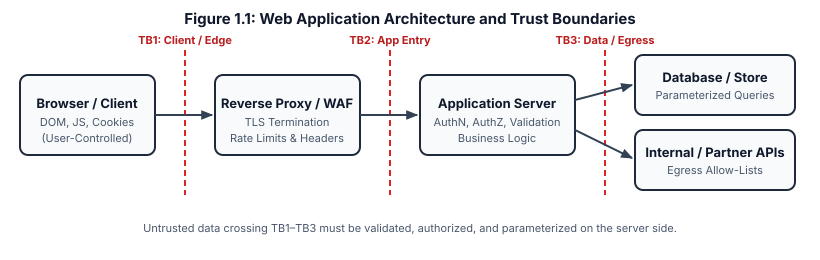
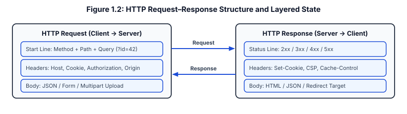

# Chapter 1: Ethics, Authorization, and HTTP Foundations

## Learning Objectives

By the end of this chapter, you should be able to:

1. Explain the difference between technical curiosity and authorized security testing, and write a bounded scope statement.
2. Trace the HTTP request and response lifecycle, including methods, status codes, headers, and message bodies.
3. Explain why HTTP is stateless and how applications layer state on top of it.
4. Identify trust boundaries in a standard web application stack and distinguish client-side controls from server-side enforcement.
5. Capture minimal, reproducible baseline evidence using browser developer tools.

---

## 1.1 Authorization Is the First Control

Web application security sits at the intersection of software engineering and adversarial testing. Before you send a single crafted request or inspect an application for weaknesses, you must answer a legal and professional question: **Do you have explicit permission to test this system?**

Curiosity is not authorization. Finding an exposed administrative endpoint or an unauthenticated API route on a public website does not grant permission to probe it further. Professional security testing operates inside a written **scope** (often formalized as Rules of Engagement) that defines five boundaries:

1. **System owner:** Who owns or operates the target and has authority to approve testing.
2. **In-scope assets:** Exact hostnames, IP ranges, ports, or application instances permitted for testing.
3. **Out-of-scope assets:** Systems, third-party services, or data stores that must not be touched.
4. **Permitted methods:** Whether active exploitation, automated scanning, or social engineering are allowed or prohibited.
5. **Stop conditions:** When testing must halt immediately—for example, if a test degrades availability or exposes unexpected personal data.

In this course, your authorized scope is strictly limited to the intentionally vulnerable local Docker containers started from `docker/docker-compose.yml` on your own workstation (`localhost` ports `3000`, `8081`, `8082`, `8083`, and `4000`). Public websites, university networks, classmates' devices, and cloud services are out of scope.

---

## 1.2 The Web Application Stack and Trust Boundaries

A modern web application is rarely a single program. Even a simple application spans multiple components across distinct execution environments:



A **trust boundary** exists wherever data moves between components with different levels of privilege, control, or validation assumptions. Two boundaries matter in every web application:

- **The Browser–Server Boundary:** Everything running in the user's browser—HTML, CSS, JavaScript, hidden form fields, cookies, and `localStorage`—is under the user's physical control. A user can inspect, pause, edit, or bypass client-side JavaScript using browser developer tools or an intercepting proxy such as OWASP ZAP or Burp Suite. Client-side validation improves usability by catching typos early, but **client-side controls never enforce security**.
- **The Application–Backend Boundary:** When application code constructs a database query, renders HTML, reads a file from disk, or calls an internal microservice, it crosses another boundary. Vulnerabilities occur when the application assumes data arriving from the browser—or from another external service—is safe without validating or parameterizing it.

When analyzing any feature, start with two questions: *What can the user control?* and *What does the server trust?* User-controlled input includes far more than visible text boxes; it includes URL paths, query strings, HTTP methods, request headers (`User-Agent`, `Referer`, `X-Forwarded-For`), cookies, JSON payloads, and uploaded file metadata.

---

## 1.3 HTTP Foundations

The Hypertext Transfer Protocol (HTTP), standardized in [IETF RFC 9110 (HTTP Semantics)](https://www.rfc-editor.org/info/rfc9110/), is a stateless, text-based (or binary-framed in HTTP/2 and HTTP/3) request-response protocol. A client opens a connection, sends a request, and receives a response.



Figure 1.2 summarizes the components of an HTTP exchange across both directions of the wire.

### Request Anatomy

An HTTP/1.1 request consists of a request line, headers, an optional blank line, and an optional body:

```http
POST /api/v1/login HTTP/1.1
Host: localhost:3000
Content-Type: application/json
Cookie: language=en
Content-Length: 45

{"email":"student@example.edu","password":"..."}
```

Key elements to inspect during baseline observation:

- **Method:** `GET` retrieves a resource and should be **safe** (no side effects) and **idempotent** (repeating the request produces the same state). `POST` submits data or triggers non-idempotent state changes. `PUT` replaces a target resource, `PATCH` applies partial modifications, and `DELETE` removes a resource. Applications do not always enforce method semantics—for example, a server might accidentally process a state change over `GET`, which exposes it to caching leaks, `Referer` leaks, and cross-site request forgery.
- **Path and Query String:** The target route (`/api/v1/login`) and any key-value parameters (`?id=42&sort=asc`). Note that URL paths are normalized differently across reverse proxies and backend frameworks, which can create authorization bypasses if the proxy and application disagree on path canonicalization.
- **Headers:** Metadata controlling host routing (`Host`), media types (`Content-Type`, `Accept`), authentication (`Authorization`), proxy forwarding (`X-Forwarded-For`, `X-Forwarded-Host`), and origin context (`Origin`, `Referer`). Because a reverse proxy often sits in front of the application, trusting unvalidated `Host` or `X-Forwarded-*` headers can lead to password-reset poisoning and routing confusion.
- **Cookies:** Key-value pairs sent automatically by the browser on matching requests.

### Response Anatomy

The server replies with a status line, response headers, and an optional body:

```http
HTTP/1.1 200 OK
Content-Type: application/json; charset=utf-8
Set-Cookie: session_id=9f8a7b6c5d4e; HttpOnly; SameSite=Lax; Path=/
Cache-Control: no-store
X-Content-Type-Options: nosniff

{"status":"authenticated"}
```

Status codes group into five classes under RFC 9110:

| Range | Meaning | Security Observation Value |
| --- | --- | --- |
| `1xx` | Informational | Protocol upgrade (e.g., `101 Switching Protocols` for WebSockets) |
| `2xx` | Success | Request accepted; confirm whether authorization actually checked the caller |
| `3xx` | Redirection | `301`/`302` redirects; check whether protected body content still leaks in the response |
| `4xx` | Client error | `400` malformed input, `401` unauthenticated, `403` unauthorized, `404` not found |
| `5xx` | Server error | Unhandled exceptions (`500`); often signal parser confusion or missing input checks |

Status codes are signals, not proof. A `403 Forbidden` on `/admin` does not prove access control is sound if `POST /admin` or `/Admin` returns `200 OK`. Conversely, a `200 OK` on a login endpoint might still contain an error JSON message. Always read the response body and headers together.

---

## 1.4 Statelessness and Layered State

HTTP itself has no memory of previous requests. Every request arrives independently. Because web applications need to remember who logged in, what is in a shopping cart, or which step of a multi-page workflow a user completed, developers layer state onto HTTP using:

- **Cookies** ([IETF RFC 6265](https://www.rfc-editor.org/info/rfc6265/)), stored by the browser and attached automatically to matching requests.
- **Server-side sessions**, where the cookie holds only an opaque random identifier mapped to server memory or a database.
- **Bearer tokens** (such as JSON Web Tokens) sent in the `Authorization` header or stored in browser storage.
- **Hidden form fields or URL parameters**, which are entirely visible and modifiable by the client.

Many high-impact vulnerabilities appear where state assumptions break—for instance, trusting a client-supplied `role=admin` cookie or failing to invalidate a session on logout.

---

## 1.5 Minimal, Reproducible Evidence

Good security work depends on evidence quality. A full-screen screenshot with no URL, no timestamp, and no request context proves very little to an engineering team trying to reproduce and fix a bug.

Effective baseline evidence is:

- **Scoped:** Clearly identifies the authorized local target (`http://localhost:3000`).
- **Dated:** Includes when the observation occurred.
- **Reproducible:** Shows the exact method, path, headers, and input that produced the response.
- **Minimal:** Captures only what supports the claim, with unrelated tokens or personal data redacted.

In browser developer tools (Network tab), you can inspect the exact request headers, response headers, status code, and cookies for every resource loaded by a page. Learning to read raw HTTP traffic directly is the foundation for every lab in this course.

---

## Key Takeaways

- Written authorization and explicit scope boundaries must precede every security test.
- HTTP is stateless; applications layer state via cookies, sessions, and tokens, creating trust boundaries.
- Client-side validation improves usability, but only server-side enforcement provides security.

## Applied Exercise

Inspect the network requests of a local web application in browser developer tools, identify three distinct user-controlled input vectors outside HTML form fields, and draft a five-part scope statement for testing it.

## Review Questions

1. Why is client-side input validation useful for user experience yet insufficient as a security control?
2. What is the difference between a `401 Unauthorized` and a `403 Forbidden` status code under RFC 9110?
3. Why should a tester capture raw HTTP request/response metadata rather than relying solely on a cropped screenshot?
4. Name three places in an HTTP request, outside visible HTML form inputs, where a user can supply untrusted data.

## References

- IETF RFC 9110: *HTTP Semantics* — [https://www.rfc-editor.org/info/rfc9110/](https://www.rfc-editor.org/info/rfc9110/)
- IETF RFC 6265: *HTTP State Management Mechanism* — [https://www.rfc-editor.org/info/rfc6265/](https://www.rfc-editor.org/info/rfc6265/)
- OWASP Web Security Testing Guide (WSTG v4.2) — [https://wstg.owasp.org/v4.2/](https://wstg.owasp.org/v4.2/)
- OWASP Cheat Sheet Series: *HTTP Headers* — [https://cheatsheetseries.owasp.org/cheatsheets/HTTP_Headers_Cheat_Sheet.html](https://cheatsheetseries.owasp.org/cheatsheets/HTTP_Headers_Cheat_Sheet.html)
