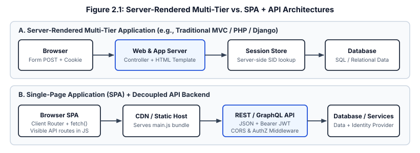
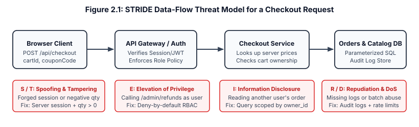

# Chapter 2: Web Architecture, Threat Modeling, and Reconnaissance

## Learning Objectives

By the end of this chapter, you should be able to:

1. Decompose a modern web application into its architectural tiers, data flows, and trust boundaries.
2. Conduct a lightweight threat model using the four core questions and STRIDE categories.
3. Distinguish passive application mapping from noisy automated scanning.
4. Build a structured attack surface inventory of endpoints, parameters, roles, and data stores.

---

## 2.1 Modern Web Application Architectures

Before testing an application, you need an accurate mental model of how it is built. Two architectural patterns dominate modern web systems:

### Server-Rendered Multi-Tier Applications

Traditional applications (such as DVWA and Mutillidae II in our lab stack) render HTML on the server. The browser submits an HTML form or requests a URL; the server queries a database, populates a template, and returns complete HTML. State typically lives in server-side sessions backed by a cookie.

### Single-Page Applications (SPAs) and API Backends

Modern applications (such as OWASP Juice Shop) separate the frontend from the backend. The browser downloads a JavaScript bundle once, renders the user interface locally, and communicates with a REST or GraphQL API using `fetch()` or `XMLHttpRequest` over JSON.

As shown in Figure 2.1, the two architectures distribute state and trust differently:
- In a **server-rendered multi-tier application** (Panel A), the browser submits forms and receives complete HTML pages; session state stays in a server-side store referenced by an opaque cookie, and routing/authorization logic lives on the server.
- In an **SPA + API backend** (Panel B), the browser downloads a static JavaScript bundle once and calls JSON endpoints using `fetch()` and Bearer tokens. This split improves UI responsiveness, but it exposes API route names, parameter schemas, and client-side role checks inside readable JavaScript bundles—making server-side authorization and CORS controls essential.

---

## 2.2 Threat Modeling: Thinking Before Testing

Threat modeling is the structured practice of identifying what can go wrong in a system before writing code or running tests. As outlined in the [OWASP Threat Modeling Cheat Sheet](https://cheatsheetseries.owasp.org/cheatsheets/Threat_Modeling_Cheat_Sheet.html), a practical threat model answers four questions:

1. **What are we building?** (Draw the architecture, data flows, and trust boundaries.)
2. **What can go wrong?** (Identify threats at each boundary.)
3. **What are we going to do about it?** (Select preventive, detective, or architectural controls.)
4. **Did we do a good enough job?** (Verify controls and update the model when features change.)

### Using STRIDE at Trust Boundaries

When reviewing a data flow diagram, security engineers commonly apply **STRIDE** to ask systematic questions about each component and boundary:

| Category | Security Property Violated | Web Application Example |
| --- | --- | --- |
| **S**poofing | Authentication | Forging a session cookie or replaying a stolen JWT |
| **T**ampering | Integrity | Modifying a hidden price field or injecting SQL syntax |
| **R**epudiation | Non-repudiation | Performing an admin deletion with no audit log entry |
| **I**nformation Disclosure | Confidentiality | Reading another user's invoice via an IDOR endpoint |
| **D**enial of Service | Availability | Triggering an expensive unpaginated export query |
| **E**levation of Privilege | Authorization | Calling `/api/admin/users` with a standard user token |

Threat modeling prevents aimless testing. Instead of throwing random payloads at every input field, you prioritize high-value assets (user credentials, payment flows, administrative functions) and the trust boundaries protecting them.

### Worked Example: Threat Modeling a Checkout Flow

As shown in Figure 2.2, tracing a single `POST /api/checkout` request across four components reveals distinct STRIDE threats at each boundary:

Consider an e-commerce checkout endpoint (`POST /api/checkout` accepting `{"cartId": 42, "couponCode": "SAVE10"}`):

- **Spoofing:** Can an unauthenticated caller or another user submit `cartId: 42`? Control: bind `cartId` to the server-side authenticated session.
- **Tampering:** Can a client supply a negative item quantity or a modified unit price? Control: look up prices strictly from the server catalog and enforce positive integer quantities.
- **Information Disclosure:** Does `GET /api/orders/42` expose another customer's shipping address? Control: enforce record ownership in the database query.
- **Elevation of Privilege:** Can a standard shopper invoke `POST /api/admin/refunds`? Control: enforce role-based middleware with deny-by-default routing.

Tying each threat directly to a data-flow boundary turns abstract security concerns into concrete engineering requirements: every arrow crossing a boundary requires an explicit validation, authentication, or authorization check.

---

## 2.3 Reconnaissance and Application Mapping

In web security, **reconnaissance** (or information gathering, mapped in [OWASP WSTG v4.2 Section 4.1](https://wstg.owasp.org/v4.2/4-Web_Application_Security_Testing/01-Information_Gathering/)) means systematically discovering how an application behaves before attempting any exploit.

### Passive vs. Active Mapping

- **Passive observation** inspects normal responses without sending malformed or high-volume traffic: reading HTML source, inspecting `robots.txt` or `sitemap.xml`, reviewing client-side JavaScript bundles, checking response headers (`Server`, `X-Powered-By`, `Content-Security-Policy`), and walking through normal user workflows with an intercepting proxy recording traffic.
- **Active probing** sends targeted requests to discover hidden routes, test parameter behavior, or verify how the server handles unexpected methods or content types.

Noisy brute-force directory scanning at high request rates is rarely the right first step. Walking the application manually with browser developer tools or OWASP ZAP / Burp Suite gives you context: you see *why* an endpoint exists, what parameters it expects, and which roles call it.

### Building an Attack Surface Inventory

An **attack surface inventory** documents every entry point where untrusted data enters the application or privileged actions occur. A clean inventory table records:

| Endpoint / Route | Method | Auth Required | Inputs / Parameters | Observed Behavior | Notes / Risk Hypothesis |
| --- | --- | --- | --- | --- | --- |
| `/rest/user/login` | `POST` | No | JSON `email`, `password` | Returns JWT token | Test rate limiting, error messages, SQLi |
| `/api/BasketItems` | `POST` | Yes | `ProductId`, `quantity` | Adds item to cart | Check negative quantity or basket ID tampering |
| `/ftp/` | `GET` | No | File path | Lists static files | Check path traversal or exposed backups |

Notice how each row connects an **endpoint**, **authentication state**, **user-controlled inputs**, and a **testable hypothesis**. This inventory becomes your test plan for the rest of the assessment.

---

## 2.4 Fingerprinting Without Overclaiming

Response headers, cookie names (`PHPSESSID`, `JSESSIONID`, `connect.sid`), error pages, and JavaScript frameworks often reveal the underlying technology stack. Knowing whether an application runs Node.js/Express, PHP, or Java/Spring helps you select relevant test cases—for example, checking prototype pollution or NoSQL patterns in Node.js versus Java deserialization in Spring.

However, fingerprinting is only a clue. Headers can be spoofed or stripped by a reverse proxy, and a framework version alone does not prove a vulnerability is reachable. Always verify behavior rather than assuming a scanner's banner match is an exploitable flaw.

---

## Key Takeaways

- Threat modeling connects architectural trust boundaries to concrete STRIDE failure modes before testing begins.
- Manual walkthroughs reveal business context, roles, and API routes that noisy automated scanners miss.
- An attack surface inventory turns reconnaissance observations into a structured, prioritized test plan.

## Applied Exercise

Draw a data-flow diagram for a password-reset feature, mark every trust boundary, and list one Spoofing, Tampering, and Information Disclosure threat with a server-side mitigation.

## Review Questions

1. Why does separating an application into a browser SPA and a JSON API expose more routing information to a tester?
2. Map each letter of STRIDE to one concrete web application failure.
3. What is the advantage of manual application walkthroughs over immediate automated directory brute-forcing?
4. What columns belong in an attack surface inventory to make it actionable for security testing?

## References

- OWASP Cheat Sheet Series: *Threat Modeling* — [https://cheatsheetseries.owasp.org/cheatsheets/Threat_Modeling_Cheat_Sheet.html](https://cheatsheetseries.owasp.org/cheatsheets/Threat_Modeling_Cheat_Sheet.html)
- OWASP Web Security Testing Guide v4.2: *4.1 Information Gathering* — [https://wstg.owasp.org/v4.2/4-Web_Application_Security_Testing/01-Information_Gathering/](https://wstg.owasp.org/v4.2/4-Web_Application_Security_Testing/01-Information_Gathering/)
- OWASP Application Security Verification Standard (ASVS) — [https://owasp.org/projects/asvs](https://owasp.org/projects/asvs)
