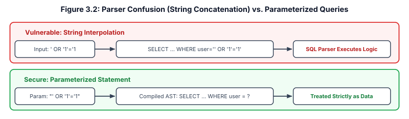
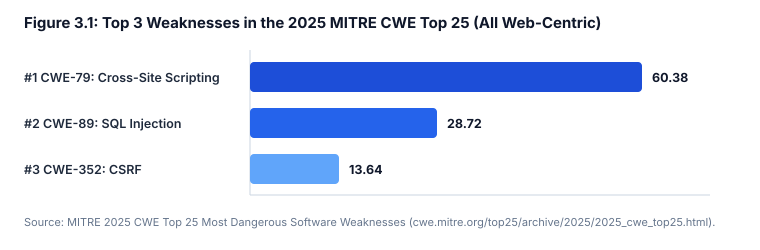

# Chapter 3: Input Validation, Encoding, and SQL Injection

## Learning Objectives

By the end of this chapter, you should be able to:

1. Explain **parser confusion** and why mixing untrusted data with command syntax causes injection vulnerabilities.
2. Distinguish input validation, output encoding, and parameterized queries, and explain where each belongs.
3. Identify in-band, error-based, and blind SQL injection patterns in vulnerable code.
4. Remediate SQL injection using prepared statements and safe ORM patterns, and explain why string escaping or blocklists fail.

---

## 3.1 Parser Confusion: The Root Cause of Injection

Every injection vulnerability—SQL injection, OS command injection, LDAP injection, or cross-site scripting—shares the same structural flaw: **the application mixes untrusted user data into a string that a downstream parser interprets as code or commands**.



Figure 3.2 contrasts the two mechanisms: with string interpolation, untrusted characters alter the SQL syntax tree directly; with a parameterized statement, the database compiles the SQL template first and binds the input strictly as literal data.

Under [OWASP Top 10:2021 A03 (Injection)](https://top10.owasp.org/2021/A03_2021-Injection/) and [MITRE CWE-89](https://cwe.mitre.org/top25/archive/2025/2025_cwe_top25.html), SQL injection remains one of the most damaging weaknesses because a single query parser boundary often guards the entire database. As shown in Figure 3.1, the top three weaknesses in the 2025 MITRE CWE Top 25 are all web-centric (`CWE-79` XSS, `CWE-89` SQL Injection, and `CWE-352` CSRF).



### Real-World Case Studies: MOVEit Transfer (`CVE-2023-34362`) and PHP-CGI (`CVE-2024-4577`)

- **Progress MOVEit Transfer (`CVE-2023-34362`, 2023):** An unauthenticated SQL injection vulnerability in the MOVEit Transfer web interface allowed attackers to manipulate backend SQL queries (MySQL, Microsoft SQL Server, or Azure SQL) and chain database access into deploying the `LEMURLOOT` ASP.NET web shell ([CISA Advisory AA23-158A](https://www.cisa.gov/news-events/cybersecurity-advisories/aa23-158a), [NVD](https://nvd.nist.gov/vuln/detail/cve-2023-34362)).
- **Windows PHP-CGI Argument Injection (`CVE-2024-4577`, 2024):** A parser-confusion flaw in Windows PHP-CGI allowed query-string characters to be converted via Windows "Best-Fit" character mapping into command-line option flags (such as `-d`), bypassing earlier protections (`CVE-2012-1823`) and enabling unauthenticated remote code execution ([CVE-2024-4577](https://www.cve.org/CVERecord?id=CVE-2024-4577)). Both cases illustrate why strict separation between untrusted input and downstream interpreters—whether SQL engines or CLI argument parsers—is non-negotiable.

---

## 3.2 Input Validation vs. Parameterization

Developers often confuse **input validation** with **injection prevention**. They serve different roles:

- **Input Validation** checks whether incoming data matches expected format, type, length, and business rules on the server before processing. Prefer **allow-lists** (e.g., `status` must be one of `["open", "closed"]`, or `age` must parse as an integer between `0` and `120`) over **deny-lists** (blocking `'`, `--`, or `SELECT`), because attackers routinely bypass deny-lists using encoding, case variation, or alternate SQL syntax.
- **Parameterization (Prepared Statements)** enforces strict separation between query structure and data values at the database driver level. Even if a user's legitimate last name is `O'Brien`—which contains a single quote—a parameterized query treats `O'Brien` strictly as a literal string value, never as SQL syntax.

Validation supports defense in depth, but **parameterization is the primary defense against SQL injection**, as documented in the [OWASP SQL Injection Prevention Cheat Sheet](https://cheatsheetseries.owasp.org/cheatsheets/SQL_Injection_Prevention_Cheat_Sheet.html).

---

## 3.3 How SQL Injection Happens in Code

Consider a vulnerable Python/SQLite query built by string formatting:

```python
# VULNERABLE: User input is concatenated directly into the SQL command
query = f"SELECT id, username, role FROM users WHERE username = '{username}' AND password_hash = '{pw_hash}'"
cursor.execute(query)
```

If a user submits `admin' --` as `username`, the resulting SQL string becomes:

```sql
SELECT id, username, role FROM users WHERE username = 'admin' --' AND password_hash = '...'
```

The `--` sequence comments out the password check entirely, authenticating the caller as `admin`.

### Common SQL Injection Techniques

1. **In-Band (UNION-based):** When query results are rendered back in the HTTP response, an attacker uses `UNION SELECT` to append rows from other tables (after matching column count and compatible types).
2. **Error-Based:** Verbose database error messages returned to the browser leak table names, column names, SQL dialect, or extracted values.
3. **Blind (Boolean-Based and Time-Based):** When the application suppresses both data and error messages, attackers infer true/false conditions by observing subtle differences in page content (`AND 1=1` vs. `AND 1=2`) or response latency (e.g., `SLEEP()` or `pg_sleep()`).

---

## 3.4 Defensive Controls and ORM Pitfalls

### Prepared Statements (Parameterized Queries)

In a parameterized query, the SQL template is compiled or bound separately from the parameters:

```python
# SECURE: Query structure and parameters are passed separately
query = "SELECT id, username, role FROM users WHERE username = ? AND password_hash = ?"
cursor.execute(query, (username, pw_hash))
```

In Node.js (`pg` or `mysql2`), PHP (`PDO`), and Java (`PreparedStatement`), the same principle applies: use placeholders (`$1`, `?`) rather than string interpolation.

### Where ORMs Still Fail

Object-Relational Mappers (ORMs) like Sequelize, SQLAlchemy, Hibernate, or Prisma parameterize standard CRUD methods by default. However, developers reintroduce SQL injection when they:

- Drop down to raw SQL helpers (e.g., `sequelize.query("SELECT * FROM users WHERE name = " + input)`).
- Interpolate **identifiers** such as `ORDER BY` column names or `ASC`/`DESC` directions, because SQL parameters cannot bind table or column names. For dynamic sorting, map user input through a strict server-side allow-list dictionary:

```python
ALLOWED_SORT_COLUMNS = {"created_at": "created_at", "price": "price"}
sort_col = ALLOWED_SORT_COLUMNS.get(user_sort, "created_at")
```

### Second-Order SQL Injection and NoSQL Operator Injection

Two related injection patterns frequently appear in modern applications:

- **Second-Order SQL Injection:** User input is safely inserted into the database using a parameterized query (e.g., registering username `admin'--`), but a later background job or reporting query reads that stored value from the database and concatenates it into a raw SQL string. Every query—not just the initial HTTP handler—must be parameterized.
- **NoSQL Operator Injection:** Document databases such as MongoDB accept structured JSON query objects. If an Express/Node.js handler passes `req.body` directly into `db.users.findOne({ username: req.body.username, password: req.body.password })`, a caller sending `{"username": "admin", "password": {"$ne": ""}}` injects a `$ne` (not-equal) query operator and bypasses authentication. Validate that expected scalar inputs are strictly strings (`typeof input === "string"`) before passing them to database drivers.

### Error Handling

Never return raw database stack traces or SQL syntax errors to the client. Log the detailed error server-side with a correlation ID and return a generic `400` or `500` response to the user.

---

## Key Takeaways

- Injection occurs when untrusted input alters the syntax tree of a downstream parser.
- Parameterized queries (prepared statements) are the primary defense against SQL injection; allow-list validation supports defense in depth.
- Dynamic SQL identifiers (`ORDER BY` columns) and second-order queries require strict allow-lists and consistent parameterization.

## Applied Exercise

Audit a sample search endpoint that interpolates a `sort` query parameter into `ORDER BY`, rewrite it using a strict allow-list dictionary, and explain why `?` placeholders cannot bind column names.

## Review Questions

1. Why do deny-list filters (such as stripping the word `SELECT` or `'`) routinely fail to stop SQL injection?
2. How does a parameterized query prevent an apostrophe in a legitimate name like `O'Connor` from breaking the query?
3. Why can SQL placeholders (`?`) not be used for dynamic `ORDER BY` column names, and how should developers secure dynamic sorting?
4. What is the difference between error-based and boolean-based blind SQL injection?

## References

- OWASP Top 10:2021 — *A03:2021 Injection* — [https://top10.owasp.org/2021/A03_2021-Injection/](https://top10.owasp.org/2021/A03_2021-Injection/)
- OWASP Cheat Sheet Series: *SQL Injection Prevention* — [https://cheatsheetseries.owasp.org/cheatsheets/SQL_Injection_Prevention_Cheat_Sheet.html](https://cheatsheetseries.owasp.org/cheatsheets/SQL_Injection_Prevention_Cheat_Sheet.html)
- MITRE CWE Top 25 (including CWE-89) — [https://cwe.mitre.org/top25/archive/2025/2025_cwe_top25.html](https://cwe.mitre.org/top25/archive/2025/2025_cwe_top25.html)
- OWASP WSTG v4.2: *Testing for SQL Injection* — [https://wstg.owasp.org/v4.2/4-Web_Application_Security_Testing/07-Input_Validation_Testing/05-Testing_for_SQL_Injection](https://wstg.owasp.org/v4.2/4-Web_Application_Security_Testing/07-Input_Validation_Testing/05-Testing_for_SQL_Injection)
