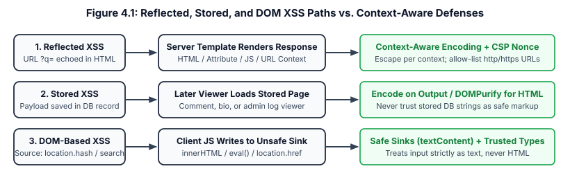

# Chapter 4: Cross-Site Scripting and Browser Execution Contexts

## Learning Objectives

By the end of this chapter, you should be able to:

1. Distinguish **reflected**, **stored**, and **DOM-based** Cross-Site Scripting (XSS).
2. Explain how browser parsing contexts (HTML body, HTML attribute, JavaScript, CSS, URL) change what constitutes dangerous characters.
3. Apply context-aware output encoding and safe DOM APIs (`textContent` vs. `innerHTML`).
4. Configure Content Security Policy (CSP) and `HttpOnly` cookies as defense-in-depth layers, and understand their limits.

---

## 4.1 Why XSS Happens

Cross-Site Scripting ([MITRE CWE-79](https://cwe.mitre.org/top25/archive/2025/2025_cwe_top25.html)) occurs when an application includes untrusted data in a web page without proper validation or **context-aware output encoding**, allowing an attacker to execute arbitrary JavaScript in another user's browser session.

Because the injected script runs inside the victim's browser under the application's **origin**, it inherits the victim's privileges for that origin. The browser has no built-in way to distinguish a legitimate `<script>` tag written by the developer from an injected tag echoed out of a search parameter or database comment once both are serialized into the same HTML response.

As a result, an attacker who achieves XSS can read sensitive DOM contents (such as CSRF tokens or account balances), issue authenticated `fetch()` requests as the victim, steal bearer tokens from `localStorage`, or perform administrative actions automatically when a privileged user views an infected page.

---

## 4.2 The Three Types of XSS



Figure 4.1 contrasts how untrusted input reaches execution across all three XSS classes and where the corresponding defense lives:

| Type | Where Payload Lives | How It Triggers | Typical Example |
| --- | --- | --- | --- |
| **Reflected** | In the immediate HTTP request (query string, path, header) | Victim clicks a crafted link; server echoes input back into the HTML response | Search page: `/search?q=<script>...` |
| **Stored (Persistent)** | Saved in a server database, comment, profile, or log viewer | Any user (or admin) who later views that stored record executes the script | Forum comment, user bio, support ticket |
| **DOM-Based** | Never needs to touch server-side rendering; stays in client-side URL/storage | Client-side JavaScript reads an untrusted **source** (e.g., `location.hash`) and writes it to an unsafe **sink** (e.g., `innerHTML`) | SPA routing or hash-based greeting banner |

### Sources and Sinks in DOM XSS

In DOM-based XSS, look for untrusted **sources** flowing into dangerous **sinks**:

- **Common Sources:** `location.search`, `location.hash`, `document.referrer`, `window.name`, `postMessage` event data.
- **Dangerous Sinks:** `element.innerHTML`, `document.write()`, `eval()`, `setTimeout(string)`, `location.href = untrustedUrl` (which executes `javascript:` URIs).

Replacing `element.innerHTML = name` with `element.textContent = name` neutralizes HTML injection because the browser treats `textContent` strictly as plain text, not markup.

---

## 4.3 Context-Aware Output Encoding

HTML entity encoding (`<` to `&lt;`, `>` to `&gt;`, `&` to `&amp;`, `"` to `&quot;`, `'` to `&#x27;`) works when inserting untrusted text into the **HTML body** or a **quoted HTML attribute**. However, HTML encoding alone is **not** enough in other browser contexts:

1. **Unquoted HTML Attribute:** `<input value=USER_INPUT>` — spaces or event handlers like `onfocus=alert(1)` can break out without using `<` or `>`. Always quote attributes.
2. **JavaScript Context:** `<script>const name = "USER_INPUT";</script>` — HTML encoding does not stop `"; alert(1); //` inside a `<script>` block, because the JS parser runs after HTML parsing. Pass data via JSON-encoded `<script type="application/json">` blocks or `data-*` attributes read by `dataset`.
3. **URL Context:** `<a href="USER_INPUT">` — HTML-encoding `javascript:alert(1)` still leaves a valid `javascript:` URI that executes when clicked. Always validate the URL scheme against an allow-list (`http:`, `https:`, or relative paths).

Modern templating engines (React JSX, Angular, Jinja2 with autoescape, Go `html/template`) apply context-aware escaping by default, but escape hatches such as `dangerouslySetInnerHTML`, `[innerHTML]`, `|safe`, or `v-html` bypass that protection.

### HTML Sanitizers and Mutation XSS (mXSS)

When an application intentionally accepts rich HTML (such as a blog editor or wiki), output encoding alone would display raw `<b>` tags as text. Instead, teams use an **allow-list HTML sanitizer** such as **DOMPurify** that parses HTML into a DOM tree, strips dangerous tags (`<script>`, `<iframe>`, `<svg>`) and event attributes (`onload`, `onerror`), and re-serializes safe markup.

Never write regex-based HTML filters (for example, stripping `<script>` with `replace()`). Browsers tolerate malformed HTML and automatically repair broken nesting—a behavior exploited by **Mutation XSS (mXSS)**, where benign-looking input mutates into an executable `<script>` or `onerror` handler when the browser's HTML parser re-parses it. Because HTML, SVG, MathML, and CSS parsers follow distinct tokenization rules, parser differentials across browser contexts are a recurring source of client-side bypasses. Modern browsers also offer **Trusted Types** (`Content-Security-Policy: require-trusted-types-for 'script'`) to restrict dangerous DOM sinks like `innerHTML` so only policy-approved objects can reach them.

---

## 4.4 Defense in Depth: `HttpOnly` and Content Security Policy

### `HttpOnly` Cookies

Setting `HttpOnly` on a session cookie prevents `document.cookie` from reading it via JavaScript. While this stops simple cookie-theft payloads, **XSS can still force the browser to make authenticated requests** using `fetch()` (because the browser attaches `HttpOnly` cookies automatically). `HttpOnly` limits impact; it does not fix XSS.

### Content Security Policy (CSP)

A [Content Security Policy](https://developer.mozilla.org/en-US/docs/Web/Security/Practical_implementation_guides/CSP) header tells the browser which script sources are allowed to execute:

```http
Content-Security-Policy: default-src 'self'; script-src 'self' 'nonce-r4nd0mV4lue'; object-src 'none'; base-uri 'self';
```

Key rules for an effective CSP:

- Avoid `'unsafe-inline'` and `'unsafe-eval'` in `script-src`, as they allow injected inline scripts to run.
- Use cryptographic **nonces** (regenerated on every response) or **hashes** for legitimate inline scripts.
- Restrict `object-src 'none'` and `base-uri 'self'` to prevent plugin abuse and `<base>` tag hijacking.

CSP is a strong second layer of defense, not a replacement for output encoding.

---

## Key Takeaways

- Reflected, stored, and DOM-based XSS differ in how payloads reach the browser but share the same root cause: unencoded or unsafe context insertion.
- Output encoding must match the exact browser context (HTML body, quoted attribute, JavaScript, or URL scheme).
- Content Security Policy (CSP) with nonces, `HttpOnly` cookies, and Trusted Types provide defense in depth.

## Applied Exercise

Examine a client-side script that reads `location.hash` into `element.innerHTML` and a template rendering `<a href="USER_URL">`. Propose the exact safe DOM API and URL-scheme check for both.

## Review Questions

1. Why does `HttpOnly` on a session cookie not completely neutralize an XSS vulnerability?
2. Give an example of an untrusted DOM source and a dangerous DOM sink, and show the safe alternative.
3. Why does HTML entity encoding fail to protect `<a href="USER_INPUT">` against `javascript:` URLs?
4. What makes `'unsafe-inline'` weaken a Content Security Policy against XSS?

## References

- MITRE CWE-79 (CWE Top 25) — [https://cwe.mitre.org/top25/archive/2025/2025_cwe_top25.html](https://cwe.mitre.org/top25/archive/2025/2025_cwe_top25.html)
- OWASP Cheat Sheet Series: *Cross Site Scripting Prevention* — [https://cheatsheetseries.owasp.org/cheatsheets/Cross_Site_Scripting_Prevention_Cheat_Sheet.html](https://cheatsheetseries.owasp.org/cheatsheets/Cross_Site_Scripting_Prevention_Cheat_Sheet.html)
- MDN Web Docs: *Content Security Policy (CSP) implementation* — [https://developer.mozilla.org/en-US/docs/Web/Security/Practical_implementation_guides/CSP](https://developer.mozilla.org/en-US/docs/Web/Security/Practical_implementation_guides/CSP)
- OWASP WSTG v4.2: *Testing for Cross Site Scripting* — [https://wstg.owasp.org/v4.2/4-Web_Application_Security_Testing/07-Input_Validation_Testing/01-Testing_for_Reflected_Cross_Site_Scripting](https://wstg.owasp.org/v4.2/4-Web_Application_Security_Testing/07-Input_Validation_Testing/01-Testing_for_Reflected_Cross_Site_Scripting)
