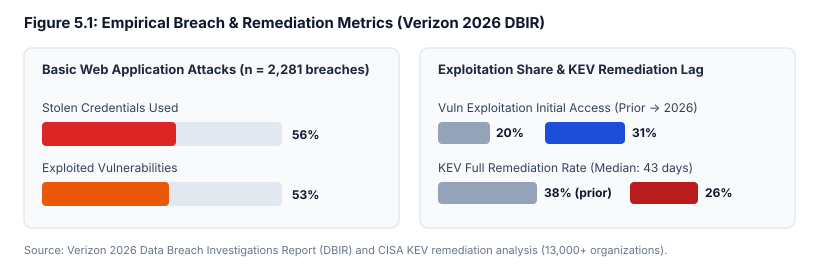
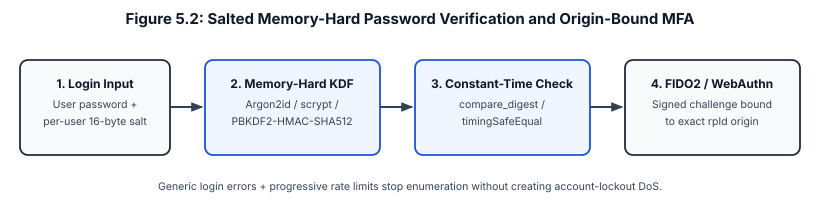

# Chapter 5: Authentication Design and Password Security

## Learning Objectives

By the end of this chapter, you should be able to:

1. Design registration, login, and password-recovery flows that resist enumeration and brute-force attacks.
2. Select and configure memory-hard password hashing algorithms (**Argon2id**, **scrypt**, **bcrypt**) and explain why fast hashes fail.
3. Apply [NIST SP 800-63B](https://csrc.nist.gov/pubs/sp/800/63/b/4/final) guidance on password length, breached-password checks, and multi-factor authentication (MFA).
4. Evaluate rate limiting, account lockout, and credential-stuffing defenses without creating denial-of-service risks.

---

## 5.1 Authentication Is More Than a Login Form

Authentication verifies **who** a claimant is before assigning a session or identity, typically combining one or more factors: something you know (a password), something you have (a FIDO2 hardware key or TOTP device), and something you are (a biometric verified locally). Under [OWASP Top 10:2021 A07 (Identification and Authentication Failures)](https://top10.owasp.org/2021/A07_2021-Identification_and_Authentication_Failures/), weaknesses rarely come from a single missing password check—they emerge across the entire identity lifecycle: registration, login, password reset, MFA enrollment, and account recovery. A strong password policy means little if an unauthenticated password-reset endpoint leaks tokens or allows unlimited guesses. In the [Verizon 2026 DBIR](https://www.verizon.com/business/resources/T343/reports/2026-dbir-data-breach-investigations-report.pdf), stolen credentials appeared in 56% of Basic Web Application Attacks, underscoring why authentication and credential hygiene remain primary targets.

---

## 5.2 Password Storage and Hashing

Applications must never store plaintext passwords or reversible encrypted passwords. If a database is leaked via SQL injection or a backup exposure, attackers should not be able to recover user passwords quickly.

### Why Fast Hashes (MD5, SHA-1, SHA-256) Fail

Cryptographic hash functions like SHA-256 are designed to be fast. Modern GPUs can compute billions of unsalted or fast-hashed guesses per second. Storing passwords with fast hashes—even with a salt—makes offline cracking trivial.

Figure 5.2 illustrates how salted memory-hard password verification pairs with constant-time comparison and origin-bound FIDO2/WebAuthn MFA.

### Salting and Work-Factor Hashing

A secure password storage design pairs a **unique per-user cryptographic salt** (defeating precomputed rainbow tables and identical-password detection) with a **slow, memory-hard key derivation function**:

- **Argon2id** (preferred by the [OWASP Password Storage Cheat Sheet](https://cheatsheetseries.owasp.org/cheatsheets/Password_Storage_Cheat_Sheet.html)): configurable memory cost, iteration count, and parallelism.
- **scrypt**: memory-hard alternative when Argon2id is unavailable.
- **bcrypt**: widely supported adaptive hash (note its 72-byte input truncation limit).
- **PBKDF2-HMAC-SHA-256 / SHA-512**: acceptable when FIPS-140 compliance is required, configured with high iteration counts.

Verification must also use a **constant-time comparison** function (`hmac.compare_digest` in Python or `crypto.timingSafeEqual` in Node.js) when comparing secret tokens or reset codes to avoid timing side channels.

---

## 5.3 Modern Password Policy (NIST SP 800-63B)

Older password rules—forcing arbitrary complexity symbols, banning spaces, and requiring 90-day password rotation—pushed users toward predictable patterns (`Spring2026!`). [NIST SP 800-63B / 800-63B-4](https://csrc.nist.gov/pubs/sp/800/63/b/4/final) recommends a practical, evidence-based model:

1. **Prioritize length over arbitrary composition:** Allow long passphrases (at least 8 characters when paired with MFA, or longer minimum lengths such as 15+ characters for single-factor passwords) and allow all printable Unicode characters including spaces.
2. **Screen against breached and common passwords:** Check new passwords at registration and password change against known breached password corpuses (e.g., using k-anonymity APIs or local bloom filters) and reject dictionary or context-specific words (like the service name or username).
3. **Do not force periodic expiration:** Rotate passwords only upon evidence or suspicion of compromise.
4. **Support password managers:** Never disable pasting into password fields.

---

## 5.4 Credential Attacks and Enumeration

### Credential Stuffing and Password Spraying

- **Credential stuffing** replays username/password pairs leaked from unrelated breaches, exploiting password reuse.
- **Password spraying** tests one or two common passwords across thousands of accounts to avoid per-account lockout thresholds.

### Real-World Case Study: Chained Gateway Authentication Bypass (`CVE-2023-46805` & `CVE-2024-21887`)

In January 2024, attackers actively chained an authentication bypass (`CVE-2023-46805`) with a command injection flaw (`CVE-2024-21887`) in Ivanti Connect Secure and Policy Secure web gateways ([NVD CVE-2024-21887](https://nvd.nist.gov/vuln/detail/cve-2024-21887), [UK NCSC Advisory](https://www.ncsc.gov.uk/news/exploitation-ivanti-vulnerabilities)). The authentication bypass allowed unauthenticated HTTP requests to reach restricted backend web endpoints, where the secondary command injection yielded full system compromise. This incident highlights why authentication must be enforced consistently across every internal route rather than relying on a single perimeter path check.

### Account Enumeration

If `/login` returns `"Unknown email address"` for unregistered users and `"Incorrect password"` for registered users, an attacker can enumerate valid accounts. Return a single generic message (`"Invalid email or password"`) and keep response timing and HTTP status codes consistent across both failure paths. Apply the same principle to password-reset forms (`"If an account matches that email, a reset link has been sent."`).

### Rate Limiting vs. Account Lockout

Hard account lockouts (locking an account permanently after 5 failed attempts) let an attacker lock out any known user on purpose—a self-inflicted denial of service. Prefer:

- Per-IP and per-account **rate limiting** with exponential backoff or temporary progressive delays.
- **Multi-Factor Authentication (MFA)**—preferring phishing-resistant **FIDO2 / WebAuthn** passkeys or hardware security keys, where the browser cryptographically binds the authentication assertion to the exact relying-party origin (`rpId`), preventing credential replay on lookalike phishing domains. When hardware keys are not feasible, prefer TOTP authenticator apps over SMS.
- **Single-use, short-lived, high-entropy password reset tokens** sent out-of-band and hashed in the database just like passwords.

---

## Key Takeaways

- Store passwords with unique per-user salts and memory-hard algorithms (Argon2id, scrypt, or bcrypt), never fast hashes.
- Follow NIST SP 800-63B: prioritize length, screen against breached passwords, and avoid arbitrary forced rotation.
- Prevent account enumeration with uniform responses and adopt phishing-resistant MFA (FIDO2/WebAuthn).

## Applied Exercise

Review a login and password-reset API that returns distinct error messages for unknown emails and locks accounts permanently after three failures. Design a replacement flow that eliminates enumeration and lockout DoS.

## Review Questions

1. Why does a unique salt prevent rainbow-table attacks, and why is salting alone insufficient without a slow/memory-hard algorithm?
2. Why does NIST SP 800-63B advise against periodic forced password rotation?
3. How can a naive account-lockout policy turn into a denial-of-service vulnerability?
4. Why should password reset endpoints return the exact same message whether or not the submitted email exists?

## References

- NIST SP 800-63B-4: *Digital Identity Guidelines: Authentication and Authenticator Management* — [https://csrc.nist.gov/pubs/sp/800/63/b/4/final](https://csrc.nist.gov/pubs/sp/800/63/b/4/final)
- OWASP Top 10:2021 — *A07:2021 Identification and Authentication Failures* — [https://top10.owasp.org/2021/A07_2021-Identification_and_Authentication_Failures/](https://top10.owasp.org/2021/A07_2021-Identification_and_Authentication_Failures/)
- OWASP Cheat Sheet Series: *Password Storage* — [https://cheatsheetseries.owasp.org/cheatsheets/Password_Storage_Cheat_Sheet.html](https://cheatsheetseries.owasp.org/cheatsheets/Password_Storage_Cheat_Sheet.html)
- OWASP WSTG v4.2: *Testing for Weak Lock Out Mechanism & Authentication* — [https://wstg.owasp.org/v4.2/4-Web_Application_Security_Testing/04-Authentication_Testing/](https://wstg.owasp.org/v4.2/4-Web_Application_Security_Testing/04-Authentication_Testing/)
