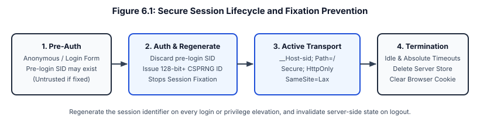

# Chapter 6: Session Management and Cookie Security

## Learning Objectives

By the end of this chapter, you should be able to:

1. Trace the full session lifecycle from creation and renewal to idle/absolute expiration and logout invalidation.
2. Configure HTTP cookie attributes (`Secure`, `HttpOnly`, `SameSite`, `Domain`, `Path`, and `__Host-` prefixes) according to [IETF RFC 6265](https://www.rfc-editor.org/info/rfc6265/).
3. Explain **session fixation** ([MITRE CWE-384](https://cwe.mitre.org/data/published/cwe_latest.pdf)) and how regenerating the session identifier on privilege change prevents it.
4. Compare opaque server-side session tokens against stateless JSON Web Tokens (JWTs) and identify common JWT pitfalls.

---

## 6.1 The Session Lifecycle

Because HTTP is stateless, an authenticated session bridges individual requests to a user identity. A secure session lifecycle has four phases:

1. **Creation:** Generate a session identifier using a cryptographically secure pseudorandom number generator (CSPRNG) with at least **128 bits of entropy** (avoid sequential IDs, timestamps, or predictable hashes of usernames).
2. **Binding and Transport:** Deliver the identifier strictly in an HTTPS `Set-Cookie` header (or an `Authorization: Bearer` header for APIs), never in a URL query string where it leaks into browser history, server logs, and `Referer` headers.
3. **Renewal on Privilege Change:** Whenever a user logs in, elevates privileges, or resets a password, **invalidate the old session ID and issue a fresh one**.
4. **Termination:** Enforce both an **idle timeout** (e.g., 15–30 minutes of inactivity) and an **absolute timeout** (maximum lifetime regardless of activity). On explicit logout, delete the session record server-side and instruct the browser to clear the cookie.



---

## 6.2 Cookie Security Attributes

Under [IETF RFC 6265](https://www.rfc-editor.org/info/rfc6265/) and the [OWASP Session Management Cheat Sheet](https://cheatsheetseries.owasp.org/cheatsheets/Session_Management_Cheat_Sheet.html), every session cookie should explicitly set defensive attributes:

```http
Set-Cookie: __Host-sid=7d9c2a...; Path=/; Secure; HttpOnly; SameSite=Lax
```

| Attribute | Security Effect | Common Mistake |
| --- | --- | --- |
| `Secure` | Browser sends cookie only over HTTPS | Omitting `Secure` allows plaintext interception on HTTP links |
| `HttpOnly` | Blocks `document.cookie` JavaScript access | Leaving it off exposes session tokens to XSS exfiltration |
| `SameSite=Lax` or `Strict` | Restricts cross-site automatic cookie attachment (mitigates CSRF) | Using `SameSite=None` without necessity |
| `Domain` | Controls subdomain scope; **omit** `Domain` to lock to exact host | Setting `Domain=.example.com` exposes the session to vulnerable subdomains |
| `Path=/` | Restricts URL path scope | Relying on `Path` as a security boundary (same-origin scripts can still read other paths) |
| `__Host-` prefix | Browser enforces `Secure`, `Path=/`, and no `Domain` attribute | Allows subdomain cookie-tossing if omitted |

---

## 6.3 Session Fixation and Hijacking

### Session Fixation

In a **session fixation** attack, the attacker obtains a valid pre-login session ID from the application (or sets one via a subdomain cookie or URL parameter), tricks the victim into authenticating with that fixed ID, and then reuses the same ID once it becomes authenticated.

**Fix:** Always regenerate the session identifier at the moment of authentication (`req.session.regenerate()` in Express, `session_regenerate_id(true)` in PHP) and discard the pre-login identifier.

### Session Hijacking vs. Replay

Session hijacking occurs when an attacker steals an active token via network sniffing (missing TLS/`Secure`), XSS (`HttpOnly` missing), or exposed logs/URLs. Short lifetimes, TLS everywhere, and binding high-risk actions to fresh re-authentication reduce the blast radius.

---

## 6.4 Opaque Server-Side Sessions vs. JWTs

Many modern SPAs use JSON Web Tokens (JWTs) instead of server-side session stores. Both models have clear trade-offs:

- **Opaque Server-Side Sessions:** The cookie holds only a random key; user state stays on the server (Redis/database). **Revocation is immediate**: deleting the server record ends the session on the next request.
- **Stateless JWTs:** The token carries signed claims (`sub`, `role`, `exp`). Because the server verifies the signature without a database lookup, **revoking a compromised JWT before `exp` expires requires a server-side denylist or short-lived access tokens paired with revocable refresh tokens**.

Common JWT security mistakes include:
- Accepting `"alg": "none"` or failing to pin the expected verification algorithm, allowing **key-confusion attacks** where an attacker signs a forged token with `HS256` using the server's public `RS256` key as the HMAC secret.
- Failing to validate `exp`, `iss`, and `aud` claims, or omitting a `jti` (JWT ID) when revocation is required.
- Storing JWTs in `localStorage` where any XSS payload can read them directly, instead of an `HttpOnly`, `Secure`, `SameSite` cookie.

### Cookie Tossing and Subdomain Isolation

Because browsers allow a compromised or untrusted subdomain (`blog.example.com`) to set cookies scoped to a parent domain (`Domain=.example.com`), an attacker controlling a subdomain can overwrite a victim's session cookie on `app.example.com` (**cookie tossing**). Always omit `Domain` on sensitive session cookies and use the `__Host-` prefix so browsers reject any cookie set with a `Domain` attribute.

---

## Key Takeaways

- Generate session identifiers with at least 128 bits of CSPRNG entropy and regenerate them on every login or privilege change.
- Harden cookies with `__Host-` prefixes, `Secure`, `HttpOnly`, and `SameSite=Lax` (omitting `Domain`).
- Stateless JWTs require short lifetimes, strict `alg`/`iss`/`aud`/`exp` validation, and a revocation strategy.

## Applied Exercise

Write an HTTP `Set-Cookie` header for a high-sensitivity web application session and justify why each attribute (`__Host-`, `Secure`, `HttpOnly`, `SameSite`, `Path`) is configured as written.

## Review Questions

1. What is session fixation, and at what exact step in the authentication flow must the server prevent it?
2. Why is omitting the `Domain` attribute on a session cookie safer than setting `Domain=.example.com`?
3. Why is immediate logout revocation harder with stateless JWTs than with opaque server-side sessions?
4. What three security guarantees does the `__Host-` cookie prefix enforce?

## References

- IETF RFC 6265: *HTTP State Management Mechanism* — [https://www.rfc-editor.org/info/rfc6265/](https://www.rfc-editor.org/info/rfc6265/)
- OWASP Cheat Sheet Series: *Session Management* — [https://cheatsheetseries.owasp.org/cheatsheets/Session_Management_Cheat_Sheet.html](https://cheatsheetseries.owasp.org/cheatsheets/Session_Management_Cheat_Sheet.html)
- OWASP Cheat Sheet Series: *JSON Web Token for Java* / *JWT Security* — [https://cheatsheetseries.owasp.org/cheatsheets/JSON_Web_Token_for_Java_Cheat_Sheet.html](https://cheatsheetseries.owasp.org/cheatsheets/JSON_Web_Token_for_Java_Cheat_Sheet.html)
- OWASP WSTG v4.2: *Testing for Session Management* — [https://wstg.owasp.org/v4.2/4-Web_Application_Security_Testing/06-Session_Management_Testing/](https://wstg.owasp.org/v4.2/4-Web_Application_Security_Testing/06-Session_Management_Testing/)
