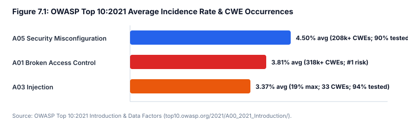
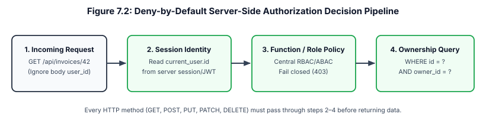

# Chapter 7: Access Control and Object-Level Authorization

## Learning Objectives

By the end of this chapter, you should be able to:

1. Distinguish **authentication** (who you are) from **authorization** (what you are permitted to do).
2. Identify **horizontal**, **vertical**, and **context-dependent** access control failures.
3. Test for Insecure Direct Object References (IDOR, [MITRE CWE-639](https://wstg.owasp.org/v4.2/4-Web_Application_Security_Testing/05-Authorization_Testing/04-Testing_for_Insecure_Direct_Object_References/)) using a multi-account test matrix.
4. Design **deny-by-default** server-side authorization checks that enforce both role permissions and record ownership.

---

## 7.1 Broken Access Control Is #1 for a Reason

Access control sits at the top of [OWASP Top 10:2021 (A01 Broken Access Control)](https://top10.owasp.org/2021/A01_2021-Broken_Access_Control/). In OWASP's 2021 empirical dataset, broken access control appeared at an average incidence rate of **3.81%** with more than **318,000 CWE occurrences**—exceeding injection (`3.37%` average incidence across 33 CWEs) in overall risk impact. Unlike SQL injection or XSS—which automated scanners often detect with syntax probes—authorization flaws are semantic. A server returning `200 OK` with JSON data for `/api/invoices/1042` looks completely normal to a scanner; only a tester who knows that User A should not read User B's invoice recognizes the vulnerability.



---

## 7.2 Horizontal, Vertical, and Function-Level Failures

Access control failures fall into three common patterns:

1. **Horizontal Privilege Escalation (IDOR):** User A accesses or modifies a resource belonging to User B at the same privilege level—for example, changing `GET /api/orders/1001` to `GET /api/orders/1002` or tampering with `{"userId": 2}` in a `POST` body.
2. **Vertical Privilege Escalation:** A standard user invokes administrative functions—for example, requesting `/admin/users` directly (**forced browsing**) or adding `"role": "admin"` to a profile update payload.
3. **Missing Function-Level or State-Transition Checks:** An application hides an "Approve" or "Delete" button in the browser UI, or checks authorization on step 1 of a checkout wizard but skips the check on step 3.

### Real-World Case Study: Next.js Middleware Authorization Bypass (`CVE-2025-29927`)

In March 2025, a critical authorization bypass (`CVE-2025-29927`, CVSS 9.1) was disclosed in Next.js ([NVD CVE-2025-29927](https://nvd.nist.gov/vuln/detail/CVE-2025-29927), [CVE Record](https://www.cve.org/CVERecord?id=CVE-2025-29927)). Applications relying solely on Next.js middleware for route protection could be bypassed by sending an external HTTP request containing the internal `x-middleware-subrequest` header, causing the framework to skip middleware execution entirely and route the request straight to the protected handler. **Never rely on a single edge or middleware layer as your sole authorization gate**—always enforce session and permission checks inside the data-access or route handler itself.

---

## 7.3 Why Predictable IDs and Hidden UI Controls Fail

Two common developer misconceptions create access control bugs:

- **Security by obscurity in the UI:** Hiding an admin link in React or Angular does not protect the backend route. Attackers read JavaScript bundles and call APIs directly with `curl` or a proxy.
- **Relying on UUIDs alone:** Switching sequential integers (`/users/42`) to UUIDv4 (`/users/550e8400-e29b-41d4-a716-446655440000`) makes guessing harder, **but UUIDs are not authorization**. UUIDs leak in URLs, logs, `Referer` headers, and list endpoints. If the server does not verify ownership on every request, the endpoint is still vulnerable to IDOR.

---

## 7.4 Deny-by-Default Authorization Architecture



As shown in Figure 7.2, every request must pass through server-derived identity, centralized role policy, and an ownership-scoped database query before returning data.

A sound authorization design follows four rules from the [OWASP Authorization Cheat Sheet](https://cheatsheetseries.owasp.org/cheatsheets/Authorization_Cheat_Sheet.html):

1. **Deny by default:** Every route and controller action requires an explicit authorization policy; unauthenticated or unannotated routes fail closed (`403 Forbidden` or `401 Unauthorized`).
2. **Derive identity from the server session, not the request body:** Never trust a client-supplied `user_id` or `role` parameter to decide who is acting. Read `current_user.id` from the verified server session or token.
3. **Enforce ownership in the data query:** Scope queries to the authenticated owner rather than fetching first and checking later when possible:

```python
# SECURE: Ownership is enforced directly in the database query
invoice = db.execute(
    "SELECT * FROM invoices WHERE id = ? AND owner_id = ?",
    (invoice_id, current_user.id)
).fetchone()
if invoice is None:
    return abort(404)
```

4. **Centralize authorization middleware:** Implement role-based (RBAC) or attribute-based (ABAC) checks in reusable middleware or policy objects rather than scattering `if user.is_admin` checks inconsistently across handlers.

---

## 7.5 Testing with a Multi-Account Matrix

To test authorization systematically in [OWASP WSTG-ATHZ](https://wstg.owasp.org/v4.2/4-Web_Application_Security_Testing/05-Authorization_Testing/04-Testing_for_Insecure_Direct_Object_References/), create at least two accounts at the same privilege level (User A and User B) and one administrative account (Admin):

| Endpoint | Admin | User A (Owner) | User B (Non-Owner) | Unauthenticated |
| --- | --- | --- | --- | --- |
| `GET /api/orders/{A_id}` | `200` (if policy allows) | `200` | Must be `403`/`404` | Must be `401` |
| `DELETE /api/orders/{A_id}` | `200` | `200` (if allowed) | Must be `403`/`404` | Must be `401` |
| `GET /api/admin/audit` | `200` | Must be `403` | Must be `403` | Must be `401` |

Test every HTTP method (`GET`, `POST`, `PUT`, `PATCH`, `DELETE`), because developers sometimes apply authorization middleware to `GET` handlers while leaving `POST` or `DELETE` unprotected.

---

## Key Takeaways

- Broken access control is a semantic flaw that automated scanners routinely miss.
- Enforce deny-by-default authorization on the server, deriving user identity strictly from verified sessions.
- Random UUIDs do not replace ownership checks; test every HTTP method using a multi-account matrix.

## Applied Exercise

Construct a four-role test matrix (Admin, Owner, Non-Owner, Unauthenticated) for `GET`, `PATCH`, and `DELETE` on `/api/invoices/{id}` and specify the expected HTTP status code for each cell.

## Review Questions

1. Why do automated vulnerability scanners struggle to detect IDOR and broken access control?
2. Explain why replacing sequential integer IDs with UUIDs does not fix an IDOR vulnerability.
3. What is the difference between horizontal and vertical privilege escalation?
4. Why should an API derive the acting `user_id` from the server-side session rather than a JSON body field?

## References

- OWASP Top 10:2021 — *A01:2021 Broken Access Control* — [https://top10.owasp.org/2021/A01_2021-Broken_Access_Control/](https://top10.owasp.org/2021/A01_2021-Broken_Access_Control/)
- OWASP WSTG v4.2: *Testing for Insecure Direct Object References* — [https://wstg.owasp.org/v4.2/4-Web_Application_Security_Testing/05-Authorization_Testing/04-Testing_for_Insecure_Direct_Object_References/](https://wstg.owasp.org/v4.2/4-Web_Application_Security_Testing/05-Authorization_Testing/04-Testing_for_Insecure_Direct_Object_References/)
- OWASP Cheat Sheet Series: *Authorization* — [https://cheatsheetseries.owasp.org/cheatsheets/Authorization_Cheat_Sheet.html](https://cheatsheetseries.owasp.org/cheatsheets/Authorization_Cheat_Sheet.html)
