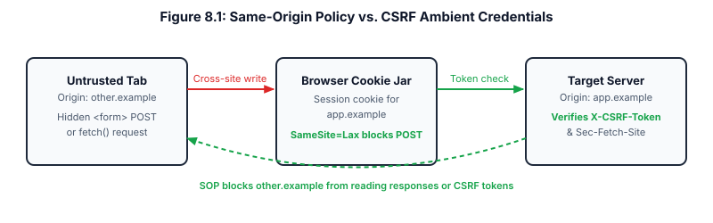

# Chapter 8: Cross-Site Request Forgery, Clickjacking, and Browser Defenses

## Learning Objectives

By the end of this chapter, you should be able to:

1. Explain the **Same-Origin Policy (SOP)** and how **ambient credentials** (automatic cookie attachment) enable Cross-Site Request Forgery (CSRF).
2. Implement and audit **synchronizer tokens**, **SameSite** cookies, and **Fetch Metadata** defenses.
3. Explain **clickjacking** (UI redressing) and prevent it using CSP `frame-ancestors` and `X-Frame-Options`.
4. Recognize why **XSS defeats all CSRF defenses** on the same origin.

---

## 8.1 The Same-Origin Policy and Ambient Authority

An **origin** is the tuple `(scheme, host, port)`. For example, `https://app.example:443` and `http://app.example:80` are different origins (different scheme and port). Under the [Same-Origin Policy (MDN)](https://developer.mozilla.org/en-US/docs/Web/Security/Defenses/Same-origin_policy), browsers generally block JavaScript in one origin from **reading** responses from another origin, **but cross-origin writes—such as HTML form submissions, links, and redirects—are permitted by default**.

When a user is signed into `app.example` with a session cookie and visits an untrusted third-party page `other.example`, a hidden `<form>` on `other.example` can submit a `POST` request to `app.example/account/email`. Because cookies act as **ambient credentials**, the browser automatically attaches the user's `app.example` session cookie unless restricted. That is **Cross-Site Request Forgery (CSRF)** ([MITRE CWE-352](https://cwe.mitre.org/top25/archive/2025/2025_cwe_top25.html)).



---

## 8.2 CSRF Defenses

Per the [OWASP CSRF Prevention Cheat Sheet](https://cheatsheetseries.owasp.org/cheatsheets/Cross-Site_Request_Forgery_Prevention_Cheat_Sheet.html), effective CSRF protection combines token-based verification with browser-level signals:

### 1. Synchronizer Token Pattern (Primary Defense)

The server generates an unpredictable, per-session (or per-request) cryptographic **CSRF token** and embeds it in the HTML form or provides it to same-origin JavaScript to send in a custom header (e.g., `X-CSRF-Token`). On every state-changing request (`POST`, `PUT`, `PATCH`, `DELETE`), the server compares the submitted token against the session's expected token using constant-time comparison.

Because the Same-Origin Policy prevents `other.example` from reading the token from `app.example`, `other.example` cannot produce a valid state-changing request.

### 2. `SameSite` Cookie Attribute

- `SameSite=Strict`: Never sends the cookie on any cross-site request, including clicking a normal link from an external site.
- `SameSite=Lax` (modern browser default): Blocks cookies on cross-site `POST` forms and background subrequests, while allowing cookies on top-level `GET` navigations.

**Warning:** `SameSite=Lax` does **not** protect `GET` endpoints that accidentally perform state changes (e.g., `GET /account/delete`). Never use `GET` for state-changing operations.

### 3. Custom Request Headers and Fetch Metadata

For JSON APIs using `fetch()`, requiring a non-simple custom header (such as `X-Requested-With` or `Authorization: Bearer <token>`) triggers a CORS preflight check (`OPTIONS`), which cross-origin pages cannot pass unless CORS is misconfigured. Modern browsers also send **Fetch Metadata** headers (`Sec-Fetch-Site: cross-site` vs. `same-origin`, `Sec-Fetch-Mode`, `Sec-Fetch-Dest`), which cannot be forged by client-side JavaScript. A server can inspect `Sec-Fetch-Site` and reject cross-site state-changing requests (`POST`, `PUT`, `DELETE`) before any business logic executes.

### 4. Double-Submit Cookie Pattern (Stateless Fallback)

When an application cannot maintain server-side session state for CSRF tokens, the **Double-Submit Cookie** pattern sets a random CSRF token in a cookie and requires the client to also send that exact token in a custom header or form field. To prevent subdomain cookie-tossing bypasses, bind the CSRF token cryptographically to the user session identifier using HMAC (`HMAC(secret, session_id + random_nonce)`).

### Why XSS Defeats CSRF Defenses

If an application has an XSS vulnerability on the same origin, injected JavaScript runs *inside* the trusted origin—it can read the CSRF token directly from the DOM and submit authenticated requests. Fixing XSS is a prerequisite for trustworthy CSRF protection.

---

## 8.3 Clickjacking (UI Redressing)

**Clickjacking** tricks a user into clicking a visible button on an untrusted page while actually clicking a transparent `<iframe>` overlaid on top—for example, a benign-looking button positioned directly over an embedded "Delete Account" or "Authorize App" button.

CSRF tokens do **not** stop clickjacking because the user is interacting with the real, legitimate page inside the iframe—the valid CSRF token is already present.

### Framing Defenses

Prevent unauthorized framing with **Content Security Policy `frame-ancestors`** (and `X-Frame-Options` for legacy browser compatibility):

```http
Content-Security-Policy: frame-ancestors 'none';
X-Frame-Options: DENY
```

Use `'self'` instead of `'none'` (`SAMEORIGIN` in `X-Frame-Options`) if the application legitimately embeds its own pages in iframes.

---

## Key Takeaways

- CSRF exploits ambient cookie attachment across origins because SOP permits cross-origin writes by default.
- Combine synchronizer tokens, `SameSite=Lax`/`Strict` cookies, and Fetch Metadata (`Sec-Fetch-Site`) for state-changing requests.
- Prevent clickjacking with `Content-Security-Policy: frame-ancestors` and `X-Frame-Options`.

## Applied Exercise

Analyze a `GET /account/disable` endpoint protected only by `SameSite=Lax` cookies. Explain why it remains vulnerable to CSRF and describe two changes required to secure it.

## Review Questions

1. Why does the Same-Origin Policy stop a cross-origin script from reading account data yet still allow a CSRF form submission?
2. Why does `SameSite=Lax` fail to protect an application that changes user email addresses via a `GET` request?
3. Why do CSRF tokens fail to prevent clickjacking, and which HTTP headers prevent clickjacking instead?
4. Explain why any XSS vulnerability on an origin undermines that origin's CSRF tokens.

## References

- MDN Web Docs: *Same-origin policy* — [https://developer.mozilla.org/en-US/docs/Web/Security/Defenses/Same-origin_policy](https://developer.mozilla.org/en-US/docs/Web/Security/Defenses/Same-origin_policy)
- OWASP Cheat Sheet Series: *Cross-Site Request Forgery Prevention* — [https://cheatsheetseries.owasp.org/cheatsheets/Cross-Site_Request_Forgery_Prevention_Cheat_Sheet.html](https://cheatsheetseries.owasp.org/cheatsheets/Cross-Site_Request_Forgery_Prevention_Cheat_Sheet.html)
- MDN Web Docs: *Cross-site request forgery (CSRF)* — [https://developer.mozilla.org/en-US/docs/Web/Security/Attacks/CSRF](https://developer.mozilla.org/en-US/docs/Web/Security/Attacks/CSRF)
- MITRE CWE-352 (CWE Top 25) — [https://cwe.mitre.org/top25/archive/2025/2025_cwe_top25.html](https://cwe.mitre.org/top25/archive/2025/2025_cwe_top25.html)
