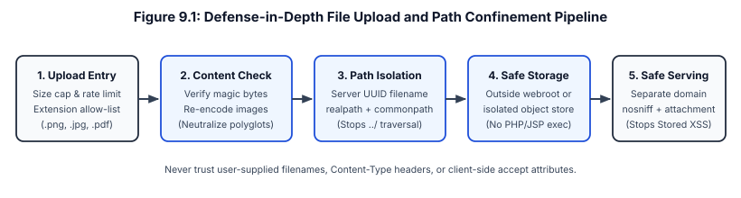

# Chapter 9: File Upload, Path Traversal, and Server-Side File Handling

## Learning Objectives

By the end of this chapter, you should be able to:

1. Explain **path traversal** ([MITRE CWE-22](https://top10.owasp.org/2021/A01_2021-Broken_Access_Control/)) and why naive string replacements like stripping `../` fail.
2. Enforce server-side **path canonicalization** and base-directory confinement.
3. Analyze **unrestricted file upload** risks (stored XSS via SVG/HTML, web shell execution, polyglots, and Denial of Service).
4. Design a defense-in-depth file upload pipeline using allow-lists, content inspection, random filenames, and isolated storage.

---

## 9.1 Path Traversal (Directory Traversal)

Path traversal occurs when an application uses untrusted input to construct a filesystem path without confining the resolved path inside an intended base directory.

Consider a download endpoint:

```python
# VULNERABLE: Direct path join without canonicalization check
file_path = os.path.join("/var/app/uploads", request.args.get("file"))
return send_file(file_path)
```

An attacker requests `?file=../../../../etc/passwd` (or URL-encoded `%2e%2e%2f`). Stripping `../` once is not enough—a naive filter turns `....//` into `../` after one pass.

### Proper Fix: Canonicalize and Verify Prefix

Resolve the **canonical absolute path** (`os.path.realpath()` in Python, `path.resolve()` in Node.js) and verify that it stays inside the canonical base directory (checking with a trailing path separator or `os.path.commonpath`):

```python
# SECURE: Canonicalize both paths and verify containment
base_dir = os.path.realpath("/var/app/uploads")
target_path = os.path.realpath(os.path.join(base_dir, user_filename))
if os.path.commonpath([base_dir, target_path]) != base_dir or target_path == base_dir:
    abort(403)
```

Even better: **avoid passing user-supplied filenames to the filesystem at all**. Map an opaque database ID (`file_id=104`) to the stored file path on the server.

### Real-World Case Study: PAN-OS GlobalProtect Path Traversal (`CVE-2024-3400`)

In April 2024, a critical zero-day vulnerability (`CVE-2024-3400`, CVSS 10.0) in Palo Alto Networks PAN-OS GlobalProtect demonstrated how path traversal in an unexpected HTTP header or cookie can escalate to full system compromise ([Picus Analysis](https://www.picussecurity.com/resource/blog/cve-2024-3400-palo-alto-pan-os-command-injection-vulnerability-explained), [Rapid7 / Cybersecurity Dive](https://www.cybersecuritydive.com/news/palo-alto-networks-firewall-exploits-grow/713605/)). When parsing the `SESSID` cookie, the service failed to validate that the value was a UUID, allowing unauthenticated `POST` requests with `../` sequences to create arbitrary files in telemetry directories whose filenames were subsequently passed to shell commands (`UPSTYLE` backdoor deployment). Path traversal is not limited to `?file=` download parameters—every cookie, header, and archive entry extracted by server code must be validated and canonicalized.

---

## 9.2 File Upload Risks

File uploads cross multiple trust boundaries at once: filename parsing, content parsing, disk storage, and later serving back to browsers.

| Failure Mode | Mechanism | Impact |
| --- | --- | --- |
| **Executable upload** | Uploading `.php`, `.jsp`, or `.aspx` into a web-accessible directory | Remote Code Execution (RCE) on the server |
| **Active browser content** | Uploading `.html` or `.svg` (which can contain `<script>`) served inline on the main origin | Stored XSS against any user who opens the file |
| **Filename injection** | Filenames containing `../`, null bytes, or OS shell metacharacters | Overwriting configuration files (`.htaccess`, `web.config`) or command execution |
| **Resource exhaustion** | Unbounded file sizes or decompression bombs (zip bombs) | Disk or memory Denial of Service |

### Why Client-Side and `Content-Type` Checks Fail

- **Client-side `<input accept=".png">`:** Easily bypassed by intercepting the `POST` request.
- **`Content-Type` header (`image/jpeg`):** Controlled entirely by the sender in the multipart request.
- **Magic-byte inspection alone:** Useful, but **polyglot files** can begin with valid GIF/JPEG magic bytes (`GIF89a`) while still containing valid PHP or HTML/JS payloads later in the file.

---

## 9.3 Defense-in-Depth Upload Pipeline



As illustrated in Figure 9.1, a resilient upload pipeline validates size and extension at entry, inspects magic bytes and re-encodes images to strip polyglot payloads, isolates the resolved path with server-generated UUID filenames, stores files outside the executable webroot, and serves downloads from a separate domain with `nosniff` and `Content-Disposition: attachment`.

Following the [OWASP File Upload Cheat Sheet](https://cheatsheetseries.owasp.org/cheatsheets/File_Upload_Cheat_Sheet.html), secure upload handling requires layered controls:

1. **Strict Extension Allow-List:** Permit only required extensions (e.g., `.png`, `.jpg`, `.pdf`), checking the final extension after normalization.
2. **Generate Server-Side Random Filenames:** Never save uploaded files under the user's original filename. Store the original name as metadata if needed, and write the file using a random UUID.
3. **Inspect and Re-encode Content:** Verify magic bytes and, for images, re-encode/strip metadata through an image library (e.g., Pillow or Sharp) to neutralize embedded payloads.
4. **Enforce Size and Rate Limits:** Reject oversized payloads at the reverse proxy and application layers.
5. **Isolate Storage and Serving:** Store uploads **outside the webroot** or in dedicated object storage (e.g., S3) served from a separate domain (`usercontent.example.net`) with `Content-Disposition: attachment` and `X-Content-Type-Options: nosniff` so browsers never execute uploaded files as HTML or scripts.

---

## Key Takeaways

- Never pass user-supplied filenames directly to filesystem APIs; canonicalize paths with `realpath` and verify containment.
- Defense-in-depth upload pipelines validate extensions, inspect magic bytes, re-encode images, and assign random UUID filenames.
- Store uploads outside executable webroots and serve them from an isolated domain with `nosniff` and `Content-Disposition: attachment`.

## Applied Exercise

Trace why a single-pass `filename.replace("../", "")` filter fails against `....//etc/passwd` and write the canonicalized path-containment check that blocks it.

## Review Questions

1. Why does stripping the substring `../` once fail to prevent path traversal?
2. Why can an uploaded `.svg` image trigger Stored XSS even when the server blocks `.php` and `.js` files?
3. What is a polyglot file, and how does re-encoding uploaded images help neutralize it?
4. Why should user-uploaded files be served from a separate domain or with `Content-Disposition: attachment` and `X-Content-Type-Options: nosniff`?

## References

- OWASP Cheat Sheet Series: *File Upload* — [https://cheatsheetseries.owasp.org/cheatsheets/File_Upload_Cheat_Sheet.html](https://cheatsheetseries.owasp.org/cheatsheets/File_Upload_Cheat_Sheet.html)
- OWASP Top 10:2021 — *A01:2021 Broken Access Control (CWE-22 Path Traversal)* — [https://top10.owasp.org/2021/A01_2021-Broken_Access_Control/](https://top10.owasp.org/2021/A01_2021-Broken_Access_Control/)
- OWASP WSTG v4.2: *Testing File Extensions & Path Traversal* — [https://wstg.owasp.org/v4.2/4-Web_Application_Security_Testing/05-Authorization_Testing/01-Testing_Directory_Traversal_File_Include](https://wstg.owasp.org/v4.2/4-Web_Application_Security_Testing/05-Authorization_Testing/01-Testing_Directory_Traversal_File_Include)
