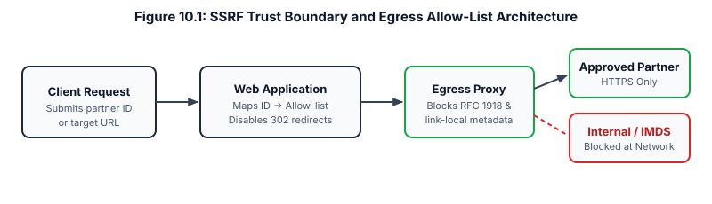

# Chapter 10: Server-Side Request Forgery, Deserialization, and Backend Trust

## Learning Objectives

By the end of this chapter, you should be able to:

1. Trace how **Server-Side Request Forgery (SSRF)** ([OWASP A10:2021](https://top10.owasp.org/2021/A10_2021-Server-Side_Request_Forgery_%28SSRF%29/)) turns a web server into an unintended proxy across backend trust boundaries.
2. Explain cloud instance metadata exposure risks and why session-token metadata protocols (such as IMDSv2) mitigate unauthenticated SSRF.
3. Design SSRF defenses using URL allow-lists, DNS resolution checks, and network egress controls.
4. Explain **unsafe deserialization** ([OWASP A08:2021](https://top10.owasp.org/2021/A08_2021-Software_and_Data_Integrity_Failures/)) and why native object serialization formats should not accept untrusted input.

---

## 10.1 Server-Side Request Forgery (SSRF)

Web applications frequently fetch remote resources on a user's behalf: importing a profile avatar from a URL, generating a link preview, rendering a document from HTML, or calling a webhook. SSRF ([MITRE CWE-918](https://cwe.mitre.org/data/published/cwe_latest.pdf)) occurs when the user controls the target destination (or part of it) and the server issues the outbound HTTP request without validating where that request goes.

Because the outbound request originates from the **server**, it inherits the server's network position: it can potentially reach loopback services, private RFC 1918 subnets, internal microservices, or cloud instance metadata services that external users cannot reach directly.

### Why Naive Blocklists Fail

Blocking literal hostnames or IP strings fails quickly because:

- **Alternate representations:** IP addresses can be written in decimal, hexadecimal, octal, or IPv6-mapped forms.
- **HTTP redirects:** A public URL that passes initial validation can return an HTTP `302` redirect to an internal address.
- **DNS rebinding:** A hostname may resolve to a public IP during validation and to a private IP milliseconds later when the HTTP client actually connects.
- **URL parser discrepancies:** Different URL parsers interpret authority delimiters (`@`), whitespace, or port numbers inconsistently.

### SSRF Defenses: Closing Parser and TOCTOU Gaps

Application-layer URL validation alone is fragile because the URL parser used during validation (e.g., Python `urllib.parse` or Node.js `url`) may interpret edge cases differently than the HTTP client library that opens the socket. This **Time-of-Check to Time-of-Use (TOCTOU)** and **parser-differential** gap is why defense in depth requires resolving DNS once, verifying the IP is public before connecting, and enforcing network-layer egress rules.

Per the [OWASP SSRF Prevention Cheat Sheet](https://cheatsheetseries.owasp.org/cheatsheets/Server_Side_Request_Forgery_Prevention_Cheat_Sheet.html):

1. **Prefer an allow-list of domains or service IDs:** If only specific partner APIs are needed, map an identifier (`partner=acme`) to a hardcoded base URL rather than accepting arbitrary URLs.
2. **Enforce network-layer egress controls:** Place outbound-fetching workers in an isolated subnet or egress proxy that blocks routing to internal RFC 1918 ranges, loopback interfaces, and link-local metadata ranges.
3. **Disable HTTP redirects** (or re-validate every redirect hop after DNS resolution) and restrict allowed schemes strictly to `https://` (blocking `file://`, `gopher://`, and similar non-HTTP schemes).
4. **Require IMDSv2 in cloud environments:** Session-oriented metadata protocols require a `PUT` request with a custom header to obtain a short-lived token, blocking simple `GET`-based SSRF against instance metadata.

---

## 10.2 Unsafe Deserialization

Serialization converts in-memory objects into bytes or text for storage or transport; **deserialization** reconstructs them. Native binary or language-specific formats—such as Java `ObjectInputStream`, Python `pickle`, PHP `unserialize()`, and .NET `BinaryFormatter`—can instantiate arbitrary classes and invoke lifecycle hooks (`__reduce__`, `readObject()`, `__wakeup()`) *during* parsing.

When an application deserializes untrusted client data (such as a base64-encoded cookie, viewstate, or message queue payload), attackers can chain existing classes on the application's classpath (**gadget chains**) to trigger unauthorized actions or code execution ([MITRE CWE-502](https://cwe.mitre.org/data/published/cwe_latest.pdf)).

### Defenses Against Unsafe Deserialization

1. **Use data-only formats:** Prefer JSON (`json.loads`, `JSON.parse`) or Protocol Buffers, which parse primitive data structures rather than executable object graphs.
2. **Never deserialize untrusted native objects:** Avoid `pickle`, `yaml.load()` (use `yaml.safe_load()`), and unauthenticated Java/PHP object streams for any input crossing a trust boundary.
3. **Integrity checks and type allow-lists:** If serialized state must leave the server, protect it with HMAC or authenticated encryption using server-managed keys, and enforce strict type allow-lists (`ObjectInputFilter` in Java) before instantiation.

---

## Key Takeaways

- SSRF turns a server into an internal network proxy; literal hostname blocklists fail against alternate IP encodings, redirects, and DNS rebinding.
- Combine strict allow-lists, redirect disabling, IMDSv2, and network-layer egress filtering.
- Avoid native binary deserialization (`pickle`, `ObjectInputStream`) on untrusted data; prefer JSON or Protocol Buffers.

## Applied Exercise

Design an outbound webhook delivery worker that must fetch partner HTTPS URLs without allowing access to RFC 1918 subnets or link-local metadata endpoints.

## Review Questions

1. Why does blocking literal strings like `localhost` fail to prevent SSRF?
2. How do HTTP `302` redirects and DNS rebinding bypass a naive pre-request IP check?
3. Why is JSON safer than Python `pickle` or Java `ObjectInputStream` for untrusted client payloads?
4. What network-layer control stops SSRF even if application-layer URL parsing has a bug?

## References

- OWASP Top 10:2021 — *A10:2021 Server-Side Request Forgery (SSRF)* — [https://top10.owasp.org/2021/A10_2021-Server-Side_Request_Forgery_%28SSRF%29/](https://top10.owasp.org/2021/A10_2021-Server-Side_Request_Forgery_%28SSRF%29/)
- OWASP Cheat Sheet Series: *Server Side Request Forgery Prevention* — [https://cheatsheetseries.owasp.org/cheatsheets/Server_Side_Request_Forgery_Prevention_Cheat_Sheet.html](https://cheatsheetseries.owasp.org/cheatsheets/Server_Side_Request_Forgery_Prevention_Cheat_Sheet.html)
- OWASP Top 10:2021 — *A08:2021 Software and Data Integrity Failures* — [https://top10.owasp.org/2021/A08_2021-Software_and_Data_Integrity_Failures/](https://top10.owasp.org/2021/A08_2021-Software_and_Data_Integrity_Failures/)
- MITRE CWE-918 & CWE-502 — [https://cwe.mitre.org/data/published/cwe_latest.pdf](https://cwe.mitre.org/data/published/cwe_latest.pdf)
