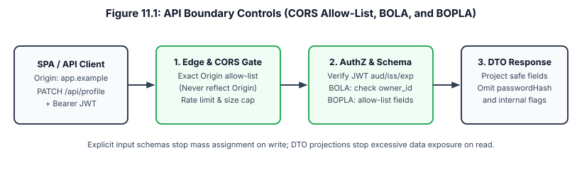

# Chapter 11: API Security and Modern Application Patterns

## Learning Objectives

By the end of this chapter, you should be able to:

1. Map REST and JSON API risks to the [OWASP API Security Top 10 (2023)](https://api-security.owasp.org/editions/2023/en/0x03-introduction/).
2. Identify **Broken Object Level Authorization (BOLA)**, **Broken Object Property Level Authorization (mass assignment / excessive data exposure)**, and **Broken Function Level Authorization (BFLA)**.
3. Audit **Cross-Origin Resource Sharing (CORS)** headers (`Access-Control-Allow-Origin`, `Access-Control-Allow-Credentials`) for origin-reflection flaws.
4. Design practical rate limiting, pagination caps, and API inventory controls.

---

## 11.1 Why APIs Have Distinct Failure Modes

Modern web applications expose JSON endpoints consumed by SPAs, mobile clients, and partner integrations. While classic injection still applies, APIs fail most often on **authorization, schema binding, and resource governance**.

The [OWASP API Security Top 10 (2023)](https://api-security.owasp.org/editions/2023/en/0x03-introduction/) highlights the primary risk categories:

| OWASP API Risk | Core Engineering Mistake | Example |
| --- | --- | --- |
| **API1: BOLA** | Failing to verify object ownership on `/api/items/{id}` | Reading or editing another tenant's record |
| **API2: Broken Authentication** | Weak token validation, missing expiration, or credential stuffing | Accepting unsigned or expired JWTs |
| **API3: Broken Object Property Level Authorization** | Returning full database objects or binding raw JSON directly to models (**mass assignment**) | Sending `{"isAdmin": true, "balance": 0}` in a profile `PATCH` |
| **API4: Unrestricted Resource Consumption** | Missing pagination limits, rate limits, or payload size caps | Requesting `?limit=10000000` |
| **API5: BFLA** | Leaving admin/internal API methods accessible to standard users | Calling `DELETE /api/v1/users/5` as a regular user |
| **API8: Security Misconfiguration** | Permissive CORS, verbose stack traces, missing TLS | Reflecting arbitrary `Origin` headers with credentials |
| **API9: Improper Inventory Management** | Leaving deprecated `/api/v1/` or shadow endpoints running unpatched | Old API version bypassing new MFA rules |

---

## 11.2 Mass Assignment, BOLA, and CORS Boundaries



Figure 11.1 shows how three independent API gates work together: the edge enforces an exact `Origin` allow-list and rate limits, the application handler verifies JWT claims, record ownership (preventing BOLA), and writable property schemas (preventing mass assignment), and the response layer projects only safe DTO fields.

ORMs make it tempting to pass `req.body` directly into a database update:

```javascript
// VULNERABLE: Raw request body bound directly to user model
await User.update(req.body, { where: { id: req.user.id } });
```

If the `User` model has `role`, `isVerified`, or `accountBalance` columns, an attacker can include those properties in the JSON body.

**Fix:** Explicitly pick allowed input fields on write (using a schema validator like Zod, Joi, or Pydantic) and explicitly project allowed output fields on read (Data Transfer Objects) so internal fields such as `passwordHash` or `internalNotes` are never serialized into API responses.

---

## 11.3 Cross-Origin Resource Sharing (CORS)

As documented in the [MDN CORS Guide](https://developer.mozilla.org/en-US/docs/Web/HTTP/Guides/CORS), CORS selectively relaxes the Same-Origin Policy so an API on `api.example` can allow a frontend on `app.example` to read its responses.

### Dangerous CORS Misconfigurations

1. **Reflecting the `Origin` header blindly:**
   ```http
   Access-Control-Allow-Origin: https://untrusted.example
   Access-Control-Allow-Credentials: true
   ```
   When combined with `Allow-Credentials: true`, **any website** can make credentialed `fetch()` requests and read the user's private API data.
2. **Trusting `Origin: null`:** Sandboxed iframes (`<iframe sandbox>`) send `Origin: null`. Allow-listing `"null"` lets untrusted pages read responses.
3. **Broken regex matching:** Checking `origin.endsWith("example.com")` matches `notexample.com`.

**Fix:** Validate the incoming `Origin` header against an exact, hardcoded set of trusted origins (`https://app.example`), never reflect arbitrary origins, and never combine `Access-Control-Allow-Credentials: true` with unvalidated origins.

---

## 11.4 Rate Limiting, GraphQL, and API Governance

Every public API needs bounded resource consumption:

- Enforce **per-user and per-IP rate limits** (returning `429 Too Many Requests` with `Retry-After`), especially on login, OTP verification, search, and export endpoints.
- Cap pagination `limit` parameters server-side (e.g., max `100` items per page).
- Maintain an **API inventory** (OpenAPI/Swagger specs matched against deployed routes) and retire deprecated API versions on a schedule so forgotten v1 endpoints do not bypass current security controls.

### GraphQL and OAuth 2.0 / OIDC Considerations

GraphQL APIs expose a single `/graphql` endpoint with flexible client-defined queries, introducing distinct failure modes:

- **Introspection exposure:** Disable schema introspection in production if the schema is not intended to be public.
- **Query depth and batching DoS:** Deeply nested queries (`user { friends { friends { ... } } }`) or batched query arrays can exhaust server CPU and database connections unless depth limits and query-cost analysis are enforced.
- **Field-level authorization:** Verify object and property permissions inside every GraphQL resolver, not only at the HTTP gateway.

For OAuth 2.0 and OpenID Connect APIs, always validate `redirect_uri` with exact string matching, verify token `aud` (audience), `iss` (issuer), and `scope` claims on every resource server, and use PKCE (`code_challenge`) for public clients.

---

## Key Takeaways

- APIs fail most often on object-level authorization (BOLA), property-level binding (BOPLA), and unrestricted resource consumption.
- Use explicit input schemas on write and DTO projections on read to stop mass assignment and excessive data exposure.
- Validate CORS `Origin` headers against exact allow-lists and enforce query-depth limits on GraphQL endpoints.

## Applied Exercise

Inspect a `PATCH /api/users/me` handler that passes `req.body` directly to an ORM update and returns the full database row. Propose an explicit input schema and DTO response.

## Review Questions

1. What is the difference between BOLA (API1) and Broken Object Property Level Authorization (API3)?
2. Why does reflecting the `Origin` header alongside `Access-Control-Allow-Credentials: true` defeat the Same-Origin Policy?
3. How do Data Transfer Objects (DTOs) and explicit input schemas prevent mass assignment and excessive data exposure?
4. Why is `API9: Improper Inventory Management` a major risk for long-lived web platforms?

## References

- OWASP API Security Top 10 (2023) — [https://api-security.owasp.org/editions/2023/en/0x03-introduction/](https://api-security.owasp.org/editions/2023/en/0x03-introduction/)
- MDN Web Docs: *Cross-Origin Resource Sharing (CORS)* — [https://developer.mozilla.org/en-US/docs/Web/HTTP/Guides/CORS](https://developer.mozilla.org/en-US/docs/Web/HTTP/Guides/CORS)
- OWASP Cheat Sheet Series: *REST Security* — [https://cheatsheetseries.owasp.org/cheatsheets/REST_Security_Cheat_Sheet.html](https://cheatsheetseries.owasp.org/cheatsheets/REST_Security_Cheat_Sheet.html)
