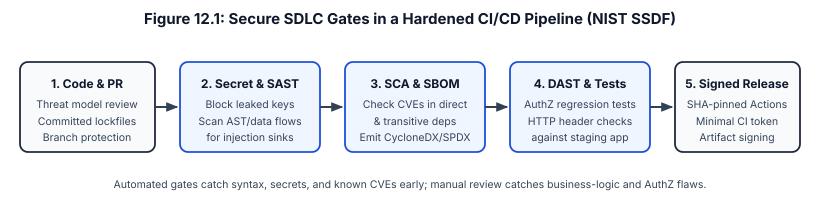

# Chapter 12: Secure SDLC, Dependency Risk, and Software Supply Chain

## Learning Objectives

By the end of this chapter, you should be able to:

1. Integrate security practices into each phase of the Software Development Lifecycle using [NIST SP 800-218 (SSDF)](https://csrc.nist.gov/pubs/sp/800/218/final).
2. Explain third-party dependency risk ([OWASP A06:2021](https://top10.owasp.org/2021/A06_2021-Vulnerable_and_Outdated_Components/)) including transitive dependencies and lockfile integrity.
3. Compare **SAST**, **DAST**, **SCA**, and **secret scanning**, and understand what each detects and misses.
4. Harden CI/CD pipelines (such as GitHub Actions) against credential leaks and supply-chain tampering.

---

## 12.1 Security Across the Development Lifecycle

Fixing a vulnerability in production costs far more than preventing it during design or catching it in pull requests. The [NIST Secure Software Development Framework (SP 800-218)](https://csrc.nist.gov/pubs/sp/800/218/final) organizes secure engineering into four groups:

1. **Prepare the Organization (PO):** Define security requirements, roles, and toolchain standards.
2. **Protect the Software (PS):** Secure source repositories, enforce branch protection, sign artifacts, and protect build environments.
3. **Produce Well-Secured Software (PW):** Threat model designs, review code, run automated testing, and configure secure defaults.
4. **Respond to Vulnerabilities (RV):** Monitor disclosures, patch affected releases, and conduct root-cause analysis so the same flaw does not recur.

---

## 12.2 Dependency Risk and Software Composition Analysis (SCA)

Modern web applications rely heavily on open-source packages (npm, PyPI, Maven, RubyGems). A typical Node.js application may declare 20 direct dependencies that pull in hundreds of **transitive dependencies**. Under [OWASP Top 10:2021 A06 (Vulnerable and Outdated Components)](https://top10.owasp.org/2021/A06_2021-Vulnerable_and_Outdated_Components/), teams inherit every vulnerability in that dependency tree.

### Practical Dependency Controls

- **Commit lockfiles** (`package-lock.json`, `poetry.lock`, `Gemfile.lock`) so builds install exact, hash-verified versions rather than floating ranges.
- **Run Software Composition Analysis (SCA)** (`npm audit`, `pip-audit`, Dependabot, Trivy) in CI to flag known CVEs.
- **Assess reachability:** Not every CVE in a transitive package is exploitable in your app. Prioritize vulnerabilities in reachable code paths and internet-facing parsers.
- **Maintain a Software Bill of Materials (SBOM)** (e.g., CycloneDX or SPDX) so you know immediately which deployed services contain a newly disclosed library vulnerability.
- **Guard against supply-chain attacks:** Watch for typosquatting, abandoned maintainer takeovers, and malicious `postinstall` scripts in package managers.

### Real-World Case Study: The Polyfill.io JavaScript CDN Attack (`CVE-2024-38526`)

In June 2024, security researchers uncovered a widespread client-side supply-chain attack after the `polyfill.io` domain and associated GitHub account were acquired by a new owner ([Sansec Research](https://sansec.io/research/polyfill-supply-chain-attack), [NVD CVE-2024-38526](https://nvd.nist.gov/vuln/detail/cve-2024-38526)). More than 100,000 websites embedding `<script src="https://cdn.polyfill.io/...">` without Subresource Integrity (SRI) began serving modified JavaScript that selectively redirected mobile users to malicious sites. Even if your own backend repository is clean, every third-party script loaded without cryptographic integrity pinning inherits the current owner of that external domain.

---

## 12.3 SAST, DAST, and Secret Scanning in CI/CD

Figure 12.1 maps automated security gates across the delivery pipeline, pairing early secret scanning and SAST on pull requests with lockfile-backed SCA/SBOM generation, dynamic staging checks, and SHA-pinned release workflows.

| Control | What It Inspects | Strengths | Limitations |
| --- | --- | --- | --- |
| **SAST** (Static Analysis) | Source code and AST/data flows | Catches injection sinks, unsafe crypto, hardcoded patterns early | High false-positive rate if untuned; misses runtime config and logic flaws |
| **DAST** (Dynamic Analysis) | Running application over HTTP | Finds missing headers, exposed files, server-rendered XSS/SQLi | Misses unauthenticated/deep business logic, IDOR, and unvisited routes |
| **SCA** | Manifests and lockfiles | Identifies known vulnerable libraries quickly | Does not find custom-written application bugs |
| **Secret Scanning** | Commits, diffs, and build logs | Catches accidentally committed API keys and tokens before merge | Cannot undo exposure if a secret was already pushed to a public repo—exposed keys must be **rotated immediately** |

### Hardening CI/CD Workflows

In GitHub Actions and similar CI systems:

- Pin third-party Actions to full **commit SHAs** rather than mutable tags (`@v3`).
- Grant `GITHUB_TOKEN` the **minimum required permissions** (`permissions: contents: read`).
- Never print secrets in build logs, and never run untrusted pull-request code in a workflow context that has access to production deployment secrets.

---

## Key Takeaways

- Commit lockfiles, maintain SBOMs, and run SCA to manage direct and transitive dependency risk.
- Pair SAST, DAST, and secret scanning in CI/CD, and rotate any credential ever pushed to Git history immediately.
- Pin third-party CI Actions to full commit SHAs and grant `GITHUB_TOKEN` least-privilege permissions.

## Applied Exercise

Audit a CI workflow that references a third-party Action via `@main` and prints environment variables during debugging. List three concrete hardening changes.

## Review Questions

1. Why does committing `package-lock.json` improve both build reproducibility and supply-chain integrity?
2. Why must an API token that was accidentally committed and pushed to GitHub be rotated even after removing it in a later commit?
3. Compare SAST and DAST: name one vulnerability class SAST finds more easily and one that requires dynamic or manual testing.
4. Why is pinning a GitHub Action to a commit SHA safer than referencing a mutable version tag?

## References

- NIST SP 800-218: *Secure Software Development Framework (SSDF) Version 1.1* — [https://csrc.nist.gov/pubs/sp/800/218/final](https://csrc.nist.gov/pubs/sp/800/218/final)
- OWASP Top 10:2021 — *A06:2021 Vulnerable and Outdated Components* — [https://top10.owasp.org/2021/A06_2021-Vulnerable_and_Outdated_Components/](https://top10.owasp.org/2021/A06_2021-Vulnerable_and_Outdated_Components/)
- OWASP Cheat Sheet Series: *Vulnerable Dependency Management* — [https://cheatsheetseries.owasp.org/cheatsheets/Vulnerable_Dependency_Management_Cheat_Sheet.html](https://cheatsheetseries.owasp.org/cheatsheets/Vulnerable_Dependency_Management_Cheat_Sheet.html)
