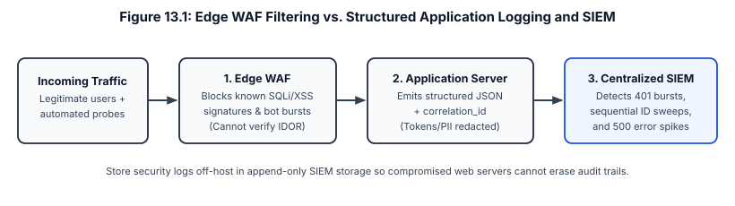

# Chapter 13: Security Logging, Monitoring, Incident Response, and WAFs

## Learning Objectives

By the end of this chapter, you should be able to:

1. Identify which security events must be logged and which sensitive values must be **redacted** ([OWASP A09:2021](https://top10.owasp.org/2021/A09_2021-Security_Logging_and_Monitoring_Failures/)).
2. Design structured, tamper-resistant logs with correlation IDs aligned to [NIST SP 800-92](https://csrc.nist.gov/pubs/sp/800/92/final).
3. Write high-signal detection rules that avoid alert fatigue during web incident triage.
4. Evaluate the capabilities and bypass limitations of Web Application Firewalls (WAFs).

---

## 13.1 Why Visibility Matters

Preventive controls fail eventually. When an application has no reliable logging or alerting—[OWASP Top 10:2021 A09 (Security Logging and Monitoring Failures)](https://top10.owasp.org/2021/A09_2021-Security_Logging_and_Monitoring_Failures/)—defenders cannot answer basic incident questions: *When did the attack start? Which accounts were accessed? Did the attacker succeed or only probe?*

Security logging differs from standard operational debugging. Operational logs track application crashes and latency; **security audit logs** record identity, authorization decisions, and state changes so responders can reconstruct an attacker's timeline. Without centralized, tamper-resistant security telemetry, attackers can probe endpoints, enumerate object IDs, or abuse stolen credentials for weeks before anyone notices.

---

## 13.2 What to Log—and What Never to Log

Per [NIST SP 800-92 (Guide to Computer Security Log Management)](https://csrc.nist.gov/pubs/sp/800/92/final) and the [OWASP Logging Cheat Sheet](https://cheatsheetseries.owasp.org/cheatsheets/Logging_Cheat_Sheet.html), applications should emit structured logs (such as JSON) with synchronized UTC timestamps, source IP, user/session ID, HTTP method, route, status code, and a **correlation ID** tying frontend requests to backend queries.

### High-Value Security Events

- Authentication successes and failures (including password resets and MFA changes).
- Authorization denials (`403 Forbidden`) and unexpected access-control exceptions.
- Input validation failures on critical fields, unusual `5xx` spikes, and administrative actions (role changes, API key creation, data exports).

### Sensitive Data That Must Never Be Logged

- Plaintext passwords, session cookies, JWTs, API keys, or credit card numbers.
- Full `Authorization` headers or unredacted PII unless legally required and access-controlled.

Also guard against **log injection (CWE-117)**: sanitize or JSON-encode newline characters (`\r`, `\n`) in user-supplied fields (like `User-Agent` or `username`) so attackers cannot forge fake log entries or corrupt log parsers.

---

## 13.3 Detection Engineering and Alert Quality

Logging everything without tuning alerts creates **alert fatigue**—analysts ignore noisy dashboards and miss real intrusions. Good detection notes focus on **behavioral signals**, not just single-request signatures:

- **Credential stuffing / spraying:** High rate of `401` responses across many usernames from one IP/ASN, or many failures for one user followed by a sudden success.
- **IDOR / enumeration:** One authenticated session requesting hundreds of sequential object IDs (`/api/invoices/1001..1250`) and receiving repeated `200`/`403` responses.
- **Exploitation follow-through:** A `500` error or unusual query parameter followed by outbound network connections or anomalous admin creation.
- **Parser and path-traversal probing:** Repeated `400`/`403`/`404` responses containing encoded traversal sequences (`%2e%2e%2f`) or unexpected internal headers (`x-middleware-subrequest`).

Centralize logs off the web server into a write-once or centralized SIEM store so an attacker who compromises the host cannot erase local log files. Retain logs long enough to support post-incident timelines—many breaches go undetected for weeks before forensic triage begins.

---

## 13.4 Web Application Firewalls (WAFs) and SIEM Telemetry

As shown in Figure 13.1, an edge WAF filters known syntax signatures and volumetric floods before traffic hits application threads, while the application server emits structured, redacted JSON logs with correlation IDs to an off-host SIEM capable of detecting behavioral attacks such as credential stuffing and sequential IDOR sweeps.

A **Web Application Firewall (WAF)** inspects HTTP/HTTPS traffic in front of the application and blocks or alerts on suspicious patterns (such as common SQLi/XSS signatures or anomalous request rates).

### What a WAF Does Well

- **Virtual patching:** Buys engineering teams time to deploy a real code fix after a new CVE is disclosed.
- **Bot and rate-limit enforcement:** Drops obvious automated scanners and volumetric credential-stuffing traffic before it hits application threads.

### What a WAF Cannot Fix

- **Business logic and authorization flaws:** A WAF cannot tell whether User A is authorized to view `/api/orders/1042` (IDOR).
- **Parser differentials and bypasses:** Attackers use encoding tricks, alternate HTTP methods, JSON/XML nesting, or payload fragmentation to slip past regex signatures.

A WAF is a **compensating and detective layer**, never a substitute for parameterized queries, output encoding, and server-side access control.

---

## Key Takeaways

- Emit structured JSON logs with UTC timestamps, correlation IDs, and neutralized newlines (preventing CWE-117 log injection).
- Never log plaintext passwords, session cookies, JWTs, or `Authorization` headers.
- Treat WAFs as compensating syntax filters; pair them with off-host SIEM alerts for behavioral attacks.

## Applied Exercise

Design a JSON log schema for authentication and authorization events, specifying which fields are captured, which are redacted, and one SIEM alert rule for IDOR enumeration.

## Review Questions

1. Why should security logs use structured JSON and correlation IDs rather than unstructured plain-text strings?
2. Name three sensitive values that must be redacted before writing HTTP request metadata to logs.
3. Why can a WAF not reliably detect or block an IDOR vulnerability?
4. What is log injection, and how does structured JSON logging prevent it?

## References

- OWASP Top 10:2021 — *A09:2021 Security Logging and Monitoring Failures* — [https://top10.owasp.org/2021/A09_2021-Security_Logging_and_Monitoring_Failures/](https://top10.owasp.org/2021/A09_2021-Security_Logging_and_Monitoring_Failures/)
- NIST SP 800-92: *Guide to Computer Security Log Management* — [https://csrc.nist.gov/pubs/sp/800/92/final](https://csrc.nist.gov/pubs/sp/800/92/final)
- OWASP Cheat Sheet Series: *Logging* — [https://cheatsheetseries.owasp.org/cheatsheets/Logging_Cheat_Sheet.html](https://cheatsheetseries.owasp.org/cheatsheets/Logging_Cheat_Sheet.html)
