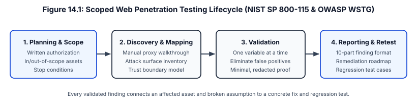

# Chapter 14: Scoped Penetration Testing, Evidence, and Remediation Reporting

## Learning Objectives

By the end of this chapter, you should be able to:

1. Execute a structured web penetration test following [NIST SP 800-115](https://csrc.nist.gov/pubs/sp/800/115/final) and [OWASP WSTG v4.2](https://wstg.owasp.org/v4.2/).
2. Validate findings manually to eliminate scanner false positives.
3. Document findings with minimal, reproducible evidence, clear severity ratings, and engineering-ready remediation guidance.
4. Deliver an executive summary and remediation roadmap for both technical and non-technical stakeholders.

---

## 14.1 Methodology: From Scope to Verification

A professional penetration test is not a race to run automated tools. Following [NIST SP 800-115](https://csrc.nist.gov/pubs/sp/800/115/final) and [OWASP WSTG v4.2](https://wstg.owasp.org/v4.2/), an engagement moves through four disciplined phases (Figure 14.1):

1. **Planning and Rules of Engagement:** Confirm written scope, target URLs/containers, allowed testing windows, test accounts, and emergency contacts.
2. **Discovery and Attack Surface Mapping:** Walk the application manually with a proxy, inventory endpoints and trust boundaries (Chapter 2), and build a targeted test plan.
3. **Validation and Controlled Exploitation:** Test hypotheses across authentication, sessions, access control, input handling, browser boundaries, APIs, and server-side requests. Prove impact with the **least intrusive proof** possible—never exfiltrate bulk data or damage availability.
4. **Reporting and Remediation Verification:** Translate validated findings into clear engineering work and define regression tests to verify the fix.

---

## 14.2 Anatomy of a High-Quality Finding

Engineers cannot fix vague complaints like *"SQL injection found on site."* Every finding in your midterm practical or capstone report must include ten concrete elements (matching the course capstone rubric):

1. **Title:** Specific weakness and location (e.g., *Unauthenticated IDOR in `/api/orders/{id}` Exposes Customer Receipts*).
2. **Severity:** Rated consistently (e.g., Critical / High / Medium / Low / Informational) based on exploitability and business impact.
3. **Affected Asset:** Exact URL, endpoint, HTTP method, and parameter.
4. **Scope Confirmation:** Verification that the target sits inside the written rules of engagement.
5. **Description:** Plain-language explanation of the failed security assumption.
6. **Reproduction Steps:** Numbered, deterministic steps another engineer can follow to reproduce the issue in under five minutes.
7. **Evidence:** Minimal, redacted HTTP request/response pairs or targeted screenshots proving the claim.
8. **Impact:** What an attacker could actually achieve (confidentiality, integrity, availability, or regulatory exposure).
9. **Remediation:** Exact code-level or configuration fix, naming where the control belongs.
10. **Regression Test Recommendation:** An automated unit, integration, or CI test that prevents the bug from returning.

A complete, reusable report template appears in **Appendix B**.

---

## 14.3 Avoiding False Positives and Overclaiming

Automated scanners frequently report informational headers or benign reflections as "High" vulnerabilities. Before including any finding in a report:

- **Verify manually:** Confirm the behavior with `curl` or your intercepting proxy.
- **Check reachability:** A missing `Strict-Transport-Security` header on a local `http://localhost` lab container is expected in local Docker; note the environment context accurately rather than inflating severity.
- **State limitations honestly:** If a test could not be completed due to time or scope boundaries, document what was and was not tested.

---

## 14.4 Executive Summary and Remediation Roadmap

Technical teams read the individual findings; leadership reads the **Executive Summary** and **Remediation Roadmap**.

- **Executive Summary:** 1–2 concise paragraphs covering engagement scope, overall risk posture, the most urgent themes (e.g., systemic missing object-level authorization), and key strengths observed.
- **Remediation Roadmap:** Group fixes by priority and effort:
  - *Immediate (0–7 days):* Critical/High exposures (unauthenticated admin routes, active SQLi/RCE, leaked secrets).
  - *Short-term (30 days):* Systemic authorization middleware, cookie hardening, CSP rollout.
  - *Long-term (60–90 days):* CI/CD SAST/SCA gates, centralized logging, developer training.

---

## Key Takeaways

- Follow disciplined scoping, manual mapping, and single-variable validation to eliminate scanner false positives.
- Every finding should pair reproducible steps and minimal redacted evidence with a concrete code fix and regression test.
- Executive summaries translate technical risk into prioritized remediation roadmaps for decision-makers.

## Applied Exercise

Take a raw vulnerability scanner alert for a missing HTTP header on a local test container and rewrite it as an accurate, non-inflated finding note.

## Review Questions

1. Why is automated scanner output alone insufficient as evidence in a penetration testing report?
2. What are the core sections of a reproducible finding, and why is a regression test recommendation included?
3. How should a tester handle a finding that appears severe in isolation but is mitigated or constrained by environment scope?
4. Who is the primary audience for the Executive Summary, and how does its focus differ from the Technical Findings section?

## References

- NIST SP 800-115: *Technical Guide to Information Security Testing and Assessment* — [https://csrc.nist.gov/pubs/sp/800/115/final](https://csrc.nist.gov/pubs/sp/800/115/final)
- OWASP Web Security Testing Guide (WSTG v4.2) — [https://wstg.owasp.org/v4.2/](https://wstg.owasp.org/v4.2/)
- Course Capstone Specification: `project/capstone_penetration_testing_project.md`
