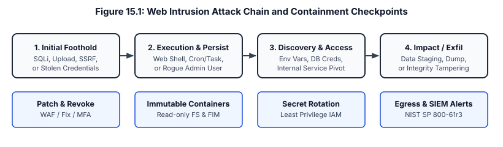

# Chapter 15: Web Intrusion, Attack Chains, and Containment

## Learning Objectives

By the end of this chapter, you should be able to:

1. Trace how attackers chain individual web vulnerabilities into full **web intrusions** (foothold, execution, discovery, persistence, and exfiltration).
2. Recognize indicators of **web shells**, rogue administrative accounts, and credential harvesting in web server environments.
3. Apply [NIST SP 800-61 Rev. 3](https://csrc.nist.gov/pubs/sp/800/61/r3/final) incident response principles to contain and eradicate a web compromise without destroying forensic evidence.
4. Interpret empirical breach metrics from the [Verizon 2026 Data Breach Investigations Report (DBIR)](https://www.verizon.com/business/resources/T343/reports/2026-dbir-data-breach-investigations-report.pdf) to prioritize web defenses.

---

## 15.1 From Single Bug to Web Intrusion

A textbook often studies vulnerabilities one by one: SQL injection in Chapter 3, file upload in Chapter 9, SSRF in Chapter 10. Real intrusions rarely stop at a single finding. Attackers chain smaller weaknesses together to move from an unauthenticated HTTP request to persistent backend access.

Empirical breach data shows why this matters. In the [Verizon 2026 DBIR](https://www.verizon.com/business/resources/T343/reports/2026-dbir-data-breach-investigations-report.pdf), Basic Web Application Attacks accounted for 2,281 confirmed breaches, with stolen credentials involved in 56% and exploited vulnerabilities in 53%. Across non-error, non-misuse breaches, vulnerability exploitation grew from 20% to 31% as an initial access vector, while only 26% of Known Exploited Vulnerabilities (KEV) were fully remediated across monitored organizations (median remediation time: 43 days).

---

## 15.2 Anatomy of a Web Intrusion Chain

### Stage 1: Initial Foothold

An intrusion begins when an external request crosses a trust boundary:

- **Credential-based entry:** Credential stuffing, password spraying, or leaked API tokens in public repositories.
- **Vulnerability exploitation:** Unrestricted file upload into an executable webroot, unsafe deserialization, OS command injection, or SQL injection leading to database reads or file writes.

### Stage 2: Execution and Persistence

Once code execution or administrative access is achieved, attackers establish reliable return paths:

- **Web shells:** Lightweight scripts (PHP, JSP, ASPX, or modified Node.js routes) placed in writable web directories that accept commands over HTTP parameters or headers. In the 2023 MOVEit Transfer campaign (`CVE-2023-34362`), attackers chained SQL injection into deploying the `LEMURLOOT` ASP.NET web shell to extract files and database records ([CISA AA23-158A](https://www.cisa.gov/news-events/cybersecurity-advisories/aa23-158a)). Similarly, in the 2024 PAN-OS GlobalProtect campaign (`CVE-2024-3400`), attackers deployed the `UPSTYLE` Python backdoor for persistent command execution.
- **Rogue accounts and tokens:** Creating hidden administrative users, adding unauthorized OAuth/API keys, or modifying password-reset hooks.
- **Scheduled tasks:** Adding cron jobs or startup hooks in mutable container filesystems.

### Stage 3: Discovery and Credential Access

From the application host, an intruder inspects environment variables (`process.env`), `.env` configuration files, database connection strings, and cloud metadata services to pivot from the web tier to the database or internal APIs.

### Stage 4: Impact and Exfiltration

The final stage extracts database dumps, stages archives in temporary directories, or modifies application files (such as injecting payment-skimming JavaScript into checkout templates).

---

## 15.3 Defensive Architecture Against Web Intrusions

Preventing initial bugs is essential, but resilient systems assume a boundary may eventually fail and design **post-exploitation friction**:

1. **Read-Only Root Filesystems:** Run web application containers with `read_only: true` and non-root users. If the web process cannot write to `/var/www/html` or application code directories, dropping a web shell fails.
2. **Least-Privilege Database & IAM Roles:** The web application's database user should have `SELECT/INSERT/UPDATE/DELETE` on application tables—never `FILE`, `SUPER`, or OS-execution privileges.
3. **Egress Filtering:** Web servers rarely need to initiate arbitrary outbound connections. Blocking unexpected outbound traffic breaks reverse shells and limits data exfiltration.
4. **File Integrity Monitoring (FIM) and Route Auditing:** Alert immediately on unexpected file modifications in application directories or newly registered administrative accounts.

---

## 15.4 Containment and Triage (NIST SP 800-61 Rev. 3)

Following [NIST SP 800-61 Rev. 3](https://csrc.nist.gov/pubs/sp/800/61/r3/final), when a web intrusion is suspected:

1. **Preserve evidence before wiping:** Snapshot the container or disk, export centralized access/application logs, and capture volatile state before restarting services.
2. **Contain cleanly:** Isolate the compromised host or revoke network ingress while keeping forensic copies intact.
3. **Rotate all exposed secrets:** Assume every database password, JWT signing key, TLS private key, and API token readable from that host is compromised.
4. **Eradicate the root cause:** Deleting a web shell without patching the file-upload or deserialization bug invites immediate re-compromise.

---

## Key Takeaways

- Real intrusions chain initial entry bugs or stolen credentials into web shells, persistence, credential discovery, and exfiltration.
- Read-only container filesystems, least-privilege database roles, and egress filtering add critical post-exploitation friction.
- During incident triage (NIST SP 800-61 Rev. 3), preserve forensic evidence before teardown and rotate all host-accessible secrets.

## Applied Exercise

Given a suspected web shell upload on a containerized web app, write a four-step containment and recovery sequence that preserves evidence and prevents re-exploitation.

## Review Questions

1. Why does running a web container with a read-only filesystem disrupt web-shell persistence even if an upload bug exists?
2. According to the Verizon 2026 DBIR, what are the two dominant initial actions in Basic Web Application Attacks?
3. Why must every secret in a compromised web server's environment variables be rotated during incident recovery?
4. What is the risk of immediately rebooting or destroying a compromised container before capturing logs and filesystem state?

## References

- NIST SP 800-61 Rev. 3: *Incident Response Recommendations and Considerations for Cybersecurity Risk Management* — [https://csrc.nist.gov/pubs/sp/800/61/r3/final](https://csrc.nist.gov/pubs/sp/800/61/r3/final)
- Verizon *2026 Data Breach Investigations Report (DBIR)* — [https://www.verizon.com/business/resources/T343/reports/2026-dbir-data-breach-investigations-report.pdf](https://www.verizon.com/business/resources/T343/reports/2026-dbir-data-breach-investigations-report.pdf)
- OWASP Top 10:2021 — *A01 Broken Access Control & A08 Software and Data Integrity Failures* — [https://top10.owasp.org/2021/](https://top10.owasp.org/2021/)
