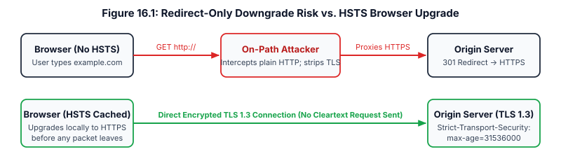

# Chapter 16: Transport Cryptography, TLS, and Modern Web Hardening

## Learning Objectives

By the end of this chapter, you should be able to:

1. Explain how **HTTPS (HTTP over TLS)** protects confidentiality, integrity, and server authenticity ([IETF RFC 9110](https://www.rfc-editor.org/info/rfc9110/), [RFC 8446](https://www.rfc-editor.org/subjects/tls/)).
2. Identify weak transport configurations (deprecated TLS 1.0/1.1, mixed content, missing certificate validation) mapped to [OWASP A02:2021 (Cryptographic Failures)](https://top10.owasp.org/2021/A02_2021-Cryptographic_Failures/).
3. Configure **HTTP Strict Transport Security (HSTS)** ([RFC 6797](https://www.ietf.org/archive/id/draft-ietf-uta-rfc7525bis-11.html)) and modern browser security headers (`X-Content-Type-Options`, `Referrer-Policy`, `Permissions-Policy`).
4. Audit TLS and header posture without overclaiming local-development exceptions.

---

## 16.1 Why Transport Security Underpins Every Control

Every defense earlier in this book—`HttpOnly` cookies, CSRF tokens, password login forms, and Bearer JWTs—assumes the network channel between browser and server cannot be read or modified in transit. Without Transport Layer Security (TLS), an on-path attacker on public Wi-Fi or a compromised router can both **passively eavesdrop** on plaintext credentials and **actively tamper** with responses—for example, injecting malicious JavaScript into an unencrypted HTML page or stripping security headers.

HTTPS (HTTP over TLS) solves this by combining asymmetric authentication (verifying the server's X.509 certificate chain against trusted Certificate Authorities) with symmetric authenticated encryption (protecting both confidentiality and integrity for every HTTP request and response).

Under [OWASP Top 10:2021 A02 (Cryptographic Failures)](https://top10.owasp.org/2021/A02_2021-Cryptographic_Failures/), transport failures remain a common root cause of sensitive data exposure.

---

## 16.2 TLS 1.3 and Deprecated Protocols

Modern web servers should support **TLS 1.3** ([RFC 8446](https://www.rfc-editor.org/subjects/tls/)) and optionally **TLS 1.2** with strong forward-secret cipher suites (AEAD ciphers such as AES-GCM or ChaCha20-Poly1305).

- **Disable legacy protocols:** SSL 2.0, SSL 3.0, TLS 1.0, and TLS 1.1 are formally deprecated by the IETF (**RFC 8996**) due to structural cryptographic weaknesses and padding-oracle attacks.
- **Forward secrecy:** Ephemeral key exchange (ECDHE) ensures that even if a server's long-term private key is compromised later, past recorded traffic cannot be decrypted.
- **Certificate verification:** Clients and backend services calling partner APIs must verify both the certificate chain and hostname match. Disabling verification (`verify=False` or `NODE_TLS_REJECT_UNAUTHORIZED=0`) in production turns HTTPS into unauthenticated encryption vulnerable to active interception.

---

## 16.3 HSTS and Mixed Content

Even when a site supports HTTPS, a user typing `example.com` in the address bar starts with an initial plain `http://` request before being redirected to `https://`. An on-path attacker can intercept that first unencrypted redirect (**SSL stripping**).

### HTTP Strict Transport Security (HSTS)

Sending the `Strict-Transport-Security` header instructs browsers to automatically upgrade all future requests for that host to HTTPS before sending any packet over the network:

```http
Strict-Transport-Security: max-age=31536000; includeSubDomains
```



### Mixed Content and Subresource Integrity (SRI)

A page loaded over `https://` that embeds an external `<script src="http://...">` reintroduces tampering risk. Modern browsers block **active mixed content** (scripts, stylesheets, `fetch()` over HTTP) by default. When loading third-party scripts or stylesheets from a CDN over HTTPS, add **Subresource Integrity (`integrity="sha384-..."`)** so the browser verifies the cryptographic hash of the downloaded asset before executing it.

---

## 16.4 Essential Security Response Headers

Beyond TLS and CSP, a hardened web server emits a consistent baseline of response headers ([OWASP HTTP Headers Cheat Sheet](https://cheatsheetseries.owasp.org/cheatsheets/HTTP_Headers_Cheat_Sheet.html)):

| Header | Recommended Value | Purpose |
| --- | --- | --- |
| `Strict-Transport-Security` | `max-age=31536000; includeSubDomains` | Forces HTTPS and prevents SSL stripping |
| `X-Content-Type-Options` | `nosniff` | Prevents browsers from MIME-sniffing non-script files as executable JS/CSS |
| `Referrer-Policy` | `strict-origin-when-cross-origin` | Prevents full URLs (and query parameters) from leaking in cross-origin `Referer` headers |
| `Permissions-Policy` | `geolocation=(), camera=(), microphone=()` | Disables unused powerful browser APIs |
| `Cache-Control` | `no-store` (on sensitive/authenticated responses) | Prevents shared proxies or browsers from caching private data |

---

## Key Takeaways

- Transport security (TLS 1.3 with forward secrecy) underpins cookies, tokens, and authentication forms.
- Disable deprecated TLS 1.0/1.1 (RFC 8996) and never disable certificate verification in production.
- Combine HSTS (`Strict-Transport-Security`), SRI for external scripts, `nosniff`, and `Referrer-Policy`.

## Applied Exercise

Audit a production web server response that redirects HTTP to HTTPS without HSTS and loads a third-party CDN script without an `integrity` attribute. Write the exact hardened headers and `<script>` tag.

## Review Questions

1. Why does redirecting `http://` to `https://` alone fail to stop SSL stripping, and how does HSTS solve this?
2. What does `verify=False` or `NODE_TLS_REJECT_UNAUTHORIZED=0` break in TLS?
3. Why is `X-Content-Type-Options: nosniff` important on endpoints serving user-uploaded or dynamic files?
4. Why does `Referrer-Policy: strict-origin-when-cross-origin` protect sensitive query parameters?

## References

- OWASP Top 10:2021 — *A02:2021 Cryptographic Failures* — [https://top10.owasp.org/2021/A02_2021-Cryptographic_Failures/](https://top10.owasp.org/2021/A02_2021-Cryptographic_Failures/)
- IETF RFC 9110: *HTTP Semantics* — [https://www.rfc-editor.org/info/rfc9110/](https://www.rfc-editor.org/info/rfc9110/)
- IETF TLS Specifications (RFC 8446 / RFC 8996) — [https://www.rfc-editor.org/subjects/tls/](https://www.rfc-editor.org/subjects/tls/)
- OWASP Cheat Sheet Series: *HTTP Headers* — [https://cheatsheetseries.owasp.org/cheatsheets/HTTP_Headers_Cheat_Sheet.html](https://cheatsheetseries.owasp.org/cheatsheets/HTTP_Headers_Cheat_Sheet.html)
- MDN Web Docs: *Mixed Content* — [https://developer.mozilla.org/en-US/docs/Web/Security/Defenses/Mixed_content](https://developer.mozilla.org/en-US/docs/Web/Security/Defenses/Mixed_content)
